<div align="center">

# 🧙 AI GM Bridge

**Foundry VTT のテーブルに、AI のゲームマスターを。**

プレイヤーの発言に語りで応え、ダンジョンを掘り、NPC を演じ、声で読み上げる。<br>
Foundry Virtual Tabletop (FVTT) と Python の AI GM サーバーを WebSocket でつなぐモジュールです。

`Foundry VTT v11–v14` · `D&D 5e` · `Windows 11 + WSL2` · `Gemini` · `edge-tts / Irodori-TTS`

</div>

> この README は **Windows 11 + WSL2** で動かす前提で書いています。
>
> **動作環境**: Windows 11 + WSL2（Ubuntu） · Python 3.12+ · Foundry VTT v11–v14 · Irodori-TTS を使うときは NVIDIA の GPU

---

## 🗺️ システム構成



| 色 | つながり | 中身 |
| :--- | :--- | :--- |
| 🟦 水色 | GM のブラウザ ⇄ AI GM サーバー（WebSocket `:8765`） | 発言・部屋への進入・選択肢をサーバーへ。語り・ロール・音声・シーン作成の指示がブラウザへ |
| 🟪 紫 | 全員のブラウザ ⇄ Foundry VTT サーバー（`:30000`） | いつもの FVTT の通信。Geminiちゃんの様子もここで全員に共有 |
| 🟨 黄 | AI GM サーバー → Gemini API / agy | 文章の生成。Gemini API を先に試し、ダメなら agy |
| 🟩 緑 | AI GM サーバー → Irodori-TTS（HTTP `:8088`） | 読み上げ音声の生成（オプション）。繋がらなければ edge-tts |
| 🟢 黄緑 | AI GM サーバー → Data フォルダ | 音声 (mp3) とマップ画像 (PNG) を書き出し、FVTT が全員に配信 |

ポイントは 3 つです。

- **AI GM サーバーとつながるのは GM のブラウザだけ**です。プレイヤーのブラウザはいつも通り FVTT サーバーとだけ話します（GM が複数いても、担当は 1 人だけ）。
- **WSL のディストリビューション同士と Windows は `127.0.0.1` を共有**しています。Windows のブラウザから `ws://127.0.0.1:8765` で AI GM サーバーに、AI GM サーバーから `http://127.0.0.1:8088` で Irodori に届きます。
- サーバーが作ったファイルは **FVTT の Data フォルダに置くだけ**で、音声もマップも FVTT がプレイヤーに配ります。

---

## 🖥️ サーバーとできること

### Foundry VTT サーバー（WSL「FVTT」、ポート 30000）

いつもの FVTT です。このリポジトリは `~/foundrydata/Data/modules/ai-gm-bridge` にモジュールとして置きます。

### ai-gm-bridge モジュール（GM のブラウザの中）

| できること | 内容 |
| :--- | :--- |
| 発言の転送 | プレイヤーの発言を AI GM へ。NPC の声が届く範囲にいれば NPC 会話へ |
| チャットコマンド | `/ai` で AI に頼む・相談する（下の [コマンド一覧](#-チャットコマンド)） |
| サーバーからの指示を実行 | チャット投稿、ダイスロール、音声再生、選択カード、シーン作成、進捗表示 |
| 部屋への進入 | トークンが未探索の部屋に入ったら、情景をサーバーに頼んで読み上げ |
| NPC の自律戦闘 | 戦闘トラッカーで NPC の手番になったら、AI が考えた移動と攻撃を実行 |
| マスコット「Geminiちゃん」 | 画面の隅にいるアシスタント。状態（考え中・話し中など）を全員で共有し、GM が左クリックするとメニュー（シナリオビルダー、NPC のブレイン管理など） |

### AI GM サーバー（WSL「FVTT」、ポート 8765）

`ai_gm_server.py` と `gm_server/` の Python サーバーです。

| できること | 内容 |
| :--- | :--- |
| 🎭 AI GM の語りと判定 | プレイヤーの発言に、情景描写・NPC のセリフ・必要なダイスロールで応える |
| 💬 サポートGM | `/ai` の相談に Geminiちゃんが答える（NPC のセリフ案、ルール確認など。agy で会話を続ける） |
| 🏰 ダンジョン自動生成 | 規模・部屋密度・周回路を選ぶと、マップ画像・壁・扉・照明・部屋の情景を載せたシーンを作る。伝承と生態系はジャーナルに |
| 📜 シナリオビルダー | 地域 → 集落 → 旅路 → 遺跡・迷宮の 4 段階でシナリオを作り、地図帳ジャーナルにまとめる |
| 🗣️ NPC 会話 | 声が届く範囲の NPC が、記憶と性格に沿って返事をする |
| 📖 冒険記録 | チャットの記録をリプレイ風にまとめ、取得物・知り合った人々・訪れた場所と一緒に冒険日誌ジャーナルに書く |
| ⚔️ NPC の自律戦闘 | NPC の手番の行動を考える |
| 🔊 読み上げ | 語りや情景を音声にする（edge-tts か Irodori-TTS） |
| 📝 詳細ログ | `~/ai-gm-logs` に 10 日分（API キーは伏せる） |

文章の生成は **Gemini API → agy（Antigravity CLI）** の順に試します。Gemini API が混んでいたりキーが無かったりしても、agy で続けられます。

### Irodori-TTS-Server（オプション、ポート 8088）

声の説明文から声を作れる、GPU で動く読み上げサーバーです。無くても edge-tts で読み上げます。詳しくは [補足](#-補足オプション) へ。

### クラウド

| サービス | 使いどころ |
| :--- | :--- |
| Google Gemini API（`gemini-3.8-flash`） | 語り・ダンジョン・NPC の生成。`GEMINI_API_KEY` が必要 |
| Antigravity（agy） | サポートGM の会話と、Gemini API の予備。agy にログインしておく |
| edge-tts（`ja-JP-NanamiNeural`） | 標準の読み上げと、Irodori の予備。キーは不要 |

---

## 🚀 起動のイロハ

### はじめての準備（1 回だけ）

1. **WSL に FVTT を入れる**: WSL のディストリビューション（この README では名前を `FVTT` とします）に Foundry VTT を入れ、Data フォルダを `~/foundrydata/Data` にします。
2. **モジュールを置く**: このリポジトリを `~/foundrydata/Data/modules/ai-gm-bridge` に clone します。
   ```bash
   cd ~/foundrydata/Data/modules
   git clone https://github.com/xex-ken-xex/ai-gm-bridge.git
   ```
3. **セットアップを流す**: Python のライブラリ、agy、Data フォルダの書き込み権限をまとめて確かめます。何度流しても大丈夫です。
   ```bash
   cd ~/foundrydata/Data/modules/ai-gm-bridge
   ./Setup.sh
   ```
4. **Gemini の API キーを入れる**: `~/.bashrc` の最後に足します。
   ```bash
   export GEMINI_API_KEY="your-gemini-api-key"
   ```
5. **agy にログインする**: WSL で一度 `agy` を起動してログインしておきます。
6. **起動ボタンを置く**: リポジトリの `start-ai-gm.bat` を Windows のデスクトップにコピーします。中の `FVTT` は `wsl -l -v` に出る名前です。違う名前で入れている場合は書き換えてください。

### 遊ぶたびに

```
① Foundry VTT サーバーを起動       いつもの方法で（ポート 30000）
② AI GM サーバーを起動              デスクトップの start-ai-gm.bat をダブルクリック
③ ブラウザで FVTT を開く            GM でログイン → AI GM サーバーに自動で接続
```

**② のメニュー**では、どのコードで動かすかを選べます。普段は **Enter** だけで OK です。

```
  0) 最新の main を取ってきて起動 (Enter でもこれ)
  1) claude/xxxx      ← 検証したい PR のブランチ (新しい順に最大 10 件)
       10/18 06:59  コミットの説明
  ...
  c) 今のブランチのまま起動 (git を触らない)
  q) やめる
```

- 番号を入れると、`git fetch` のあとそのブランチをリモートと同じ内容にしてから起動します。
- 編集中のファイルがあるときは切り替えずに止まります（`c` なら今のまま起動できます）。
- 手元のブランチにリモートに無いコミットがあるときは、捨ててよいか確認します。
- `requirements.txt` が変わっていれば、ライブラリも自動で更新します。
- コードが切り替わったら、FVTT のブラウザを再読み込み（F5）してください。`module.json` が変わったときは F5 では反映されないので、FVTT の「セットアップに戻る」からワールドを起動し直してください（スクリプトが案内します）。

`start-ai-gm.bat` の `bash -lic` の `-i` は、`~/.bashrc` の `GEMINI_API_KEY` を読み込むために付けています。

**③ ではじめて使うワールド**では、ゲーム設定 → 「モジュールの管理」で **AI GM Bridge** を有効にします。GM でログインすると、Geminiちゃんが現れてサーバーに接続します。

### つながらないときは

| 症状 | 見るところ |
| :--- | :--- |
| 「Python サーバー (8765) に接続されていません」 | ② の黒い画面が開いたままか。閉じていたらもう一度ダブルクリック |
| 語りが返ってこない | ② の画面のログ、または `~/ai-gm-logs`。`GEMINI_API_KEY` と agy のログインを確認 |
| プレイヤー側で何も起きない | AI GM サーバーとつながるのは GM のブラウザだけ。GM が FVTT を開いているか |
| 読み上げが edge-tts の声になる | Irodori を使う設定のときは、Irodori が起動しているか（[補足](#-補足オプション)） |

---

## 💬 チャットコマンド

| コマンド | 説明 |
| :--- | :--- |
| `/ai [やりたいこと]` | Geminiちゃんが内容を読んで、当てはまるスキルを動かす（例: `/ai 港町を作りたい` → 町生成スキルでビルダーの「集落」タブを開く）。どれか決められないときは選択カードで聞き返す |
| `/ai` | できること（スキル）の一覧を出す |
| `/ai ダンジョン生成` | 選択カードで規模・部屋密度・周回路を選び、ダンジョンのシーンを作る |
| `/ai [テーマ]のダンジョン` | テーマ（例: `/ai 水没したドワーフ要塞`）に沿ってダンジョンを作る |
| `/ai ビルダー` | シナリオビルダーを開く（Geminiちゃんのメニューからも開ける） |
| `/ai NPC` | NPC のブレイン管理画面を開く（Geminiちゃんのメニューからも開ける） |
| `/ai 記録を作って` | 前の記録からのチャットを読んで、ジャーナル「📖 冒険日誌」に新しい回を書く（リプレイ風の本文・取得物・知り合った人々・訪れた場所） |
| `/ai 記録を更新して` | 最新の回に続きを書き足す（Geminiちゃんのメニュー「冒険記録を更新」と同じ） |
| `/ai [相談・指示]` | NPC のセリフや行動、ルールの相談をサポートGM にする |

---

## 📎 補足（オプション）

### Irodori-TTS で読み上げる

声の説明文（例: 「落ち着いた低めの女性の声」）から声を作る読み上げサーバーです。NVIDIA の GPU があると使えます。

- **入れ方**: [`docs/irodori_tts_setup.md`](docs/irodori_tts_setup.md) に、音声用の WSL「Irodori」を作るところから書いてあります。AI GM と同じ WSL に入れても動きます。
- **起動と停止**: 手順書の `Irodori起動.bat` / `Irodori停止.bat` をデスクトップに置いて使います。止めると GPU のメモリが空きます。
- **確認**: Windows の PowerShell で `curl.exe http://127.0.0.1:8088/health`。FVTT では Geminiちゃんのメニューの「声のテスト」で、どのエンジンで鳴ったかが分かります（音は GM にだけ鳴ります）
- **切り替え**: `~/.bashrc` に `export AI_GM_TTS_ENGINE=irodori` を足して、AI GM サーバーを起動し直します。
- 初回はモデルの読み込みで時間がかかります。Irodori に繋がらないときは edge-tts で読み上げ、60 秒後にもう一度 Irodori を試します。
- **声を選ぶ**: ナレーターの声は、説明文・乱数の種・参照音声 (気に入った mp3 や自分の声) で好みの声にできます。Geminiちゃんの声は別に決まります。手順は [`docs/irodori_tts_setup.md` の 6 章](docs/irodori_tts_setup.md#6-ナレーターの声を好みの声にする) にあります。

起動の順番は、**FVTT → Irodori → AI GM サーバー → ブラウザ** です（Irodori は後から起動しても、そのうち切り替わります）。

### AI の接続先を作業ごとに変える

NPC の会話はローカルの LM Studio、シナリオビルダーは Claude Code、というように、作業ごとに使う AI を選べます。

1. `cp ai_providers.example.json ai_providers.json` で設定ファイルを作り、接続先 (`providers`) と作業ごとの接続先 (`tasks`) を書き換えます。
2. 使える接続先は Gemini API・agy・Claude Code (`claude` CLI)・OpenAI 互換 API (LM Studio など) です。API キーはファイルに書かず、環境変数の名前 (`api_key_env`) を書きます。
3. `python3 -m gm_server.ai_routing` で、いまの振り分けとキーが設定済みかどうかを確かめられます (キーの値は出ません)。AI GM サーバーの起動時にも同じ表が出ます。

設定ファイルが無ければ今までどおりです。書き方の詳細は [`docs/specification.md` の「AI の接続先の振り分け」](docs/specification.md#ai-の接続先の振り分け) にあります。

### 環境変数

`~/.bashrc` に `export` で書きます。ほとんどは既定のままで大丈夫です。

| 変数 | 既定値 | 内容 |
| :--- | :--- | :--- |
| `GEMINI_API_KEY` | （なし） | Gemini API のキー |
| `AI_GM_GEMINI_MODEL` | `gemini-3.8-flash` | Gemini API のモデル |
| `AI_GM_GEMINI_TIMEOUT` | `120` | Gemini API の待ち時間（秒） |
| `AI_GM_AI_CONFIG` | `ai_providers.json` | AI の接続先の振り分け設定ファイル |
| `AI_GM_LLM_CONCURRENCY` | `3` | 同時に投げる問い合わせの数 |
| `AI_GM_MAPGEN_TIMEOUT` | `300` | マップ生成の待ち時間（秒） |
| `AI_GM_AGY_MODEL` | `gemini-3.8-flash-medium` | agy のモデル |
| `AI_GM_AGY_TIMEOUT` | `300` | agy の待ち時間（秒） |
| `AI_GM_ROUTER_TIMEOUT` | `45` | `/ai` のスキル判定で agy を待つ秒数。過ぎたら「応答がなかった」と知らせる |
| `AI_GM_AGY_CONCURRENCY` | `1` | agy を同時に動かす数 |
| `AI_GM_HOST` / `AI_GM_PORT` | `0.0.0.0` / `8765` | AI GM サーバーの待ち受け |
| `AI_GM_DATA_DIR` | `~/foundrydata/Data` | FVTT の Data フォルダ |
| `AI_GM_LOG_DIR` / `AI_GM_LOG_DAYS` | `~/ai-gm-logs` / `10` | 詳細ログの置き場所と保存日数 |
| `AI_GM_TTS_ENGINE` | `edge` | `irodori` にすると Irodori-TTS で読み上げ |
| `AI_GM_IRODORI_URL` | `http://127.0.0.1:8088` | Irodori-TTS-Server の URL |
| `AI_GM_IRODORI_TIMEOUT` / `_FIRST_TIMEOUT` | `20` / `180` | Irodori の待ち時間（秒、2 つ目は初回） |
| `AI_GM_IRODORI_RETRY_AFTER` | `60` | Irodori に繋がらなかった後、もう一度試すまで（秒） |

全部の一覧は [`docs/specification.md` の環境変数の表](docs/specification.md#環境変数) と `gm_server/config.py` にあります。Irodori の声の設定（`AI_GM_IRODORI_CAPTION_NARRATOR`・`AI_GM_IRODORI_CAPTION_SUPPORT`・`AI_GM_IRODORI_SEED`・`AI_GM_IRODORI_NARRATOR_VOICE` など）は、同じ表と [`docs/irodori_tts_setup.md` の 6 章](docs/irodori_tts_setup.md#6-ナレーターの声を好みの声にする) を見てください。

### WSL のターミナルから直接起動する

```bash
cd ~/foundrydata/Data/modules/ai-gm-bridge
./start_server.sh            # .bat と同じメニュー
python3 ai_gm_server.py      # メニューなしで今のコードのまま起動
```

バックグラウンドで常駐させる場合:

```bash
nohup python3 ai_gm_server.py > ai_gm_server.log 2>&1 &
```

### 疎通テスト

FVTT とだけつないで、チャット・ダイス・音声が届くかを確かめるモックサーバーです（AI GM サーバーは止めてから使います）。

```bash
python3 tools/test_send.py    # チャットとダイス
python3 tools/test_voice.py   # 音声の生成と再生
```

### 自動テスト

```bash
python3 -m pip install -r requirements-dev.txt
python3 -m pytest   # サーバー側
npm test            # FVTT 側の純粋関数 (Node 18+)
```

PR と main への push で GitHub Actions が同じテストを流します。

---

## 📂 ディレクトリ構成

```text
ai-gm-bridge/
├── Setup.sh                  # 冪等セットアップスクリプト
├── start_server.sh           # 対話式のサーバー起動スクリプト (main / ブランチを選んで起動)
├── start-ai-gm.bat           # Windows から start_server.sh を開くバッチ (デスクトップにコピーして使う)
├── README.md                 # 本ドキュメント
├── AGENTS.md                 # エージェント・開発者向け詳細仕様書
├── module.json               # FVTT モジュール定義ファイル
├── bridge.js                 # FVTT クライアント側エントリーポイント
├── scripts/                  # FVTT クライアント側の実装 (actions / builder / mascot / npc / net / lib)
├── styles/                   # FVTT クライアント側のスタイル
├── ai_gm_server.py           # WebSocket サーバー起動スクリプト
├── gm_server/                # サーバー実装 (LLM・音声・ハンドラ・ルーター・ビルダー)
├── tests/                    # 自動テスト (python: pytest / js: node:test)
├── requirements.txt          # Python 依存ライブラリ一覧
├── prompts/                  # プロンプトテンプレート
├── tools/
│   ├── dungeon_generator.py  # 幾何学・壁・グラフ生成ツール
│   ├── prompt_manager.py     # プロンプト補完・ワールド情報取得
│   ├── test_voice.py         # 音声疎通テストスクリプト
│   └── test_send.py          # チャット・ダイス疎通テストスクリプト
└── docs/                     # 詳細設計・調査仕様書
    ├── images/architecture.svg # システム構成図
    ├── specification.md      # システム全体設計書
    ├── irodori_tts_setup.md  # Irodori-TTS を WSL に入れる手順
    ├── scenario_builder_spec.md # シナリオビルダー仕様
    ├── dungeon_generator_spec.md # ダンジョン生成ツール仕様
    ├── reference_porting_review.md # reference/ 移植レビュー & 移植計画
    ├── ai_dungeon_flavor_spec.md # AI 階層フレーバー生成仕様
    ├── dungeon_math_investigation.md # グラフ・数学モデリング調査
    └── investigation_fvtt_dnd5e_control.md # FVTT制御仕様調査
```
