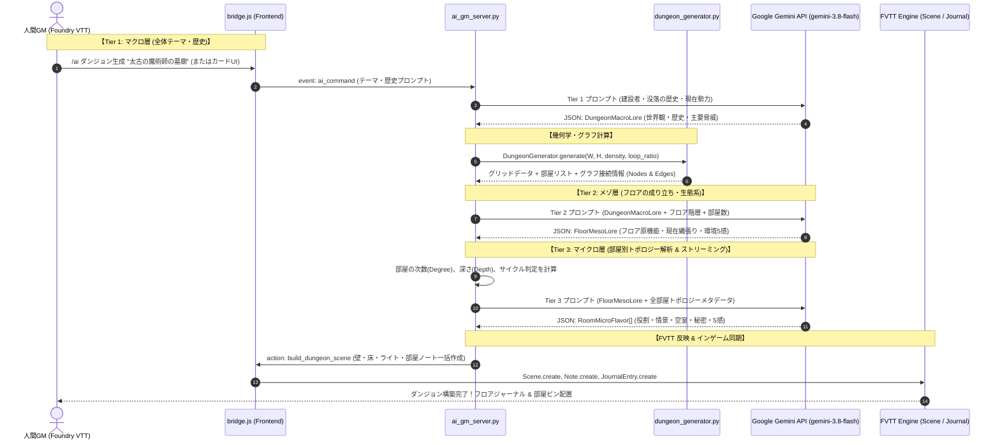

# AI ダンジョン階層フレーバー生成仕様 & TRPG/DM 設計ノウハウ調査レポート

本ドキュメントは、Foundry VTT 上でのダンジョン自動生成において、単なる幾何学的マップ（壁と床）にとどまらず、**TRPG（D&D5e / OSR）の熟練ダンジョンマスター（DM）の設計思想**と**離散グラフ理論の数学的解析**を融合させた、**AIによる3層階層フレーバー生成システム**の設計仕様および調査レポートです。

---

## 1. 熟練ダンジョンマスター（DM）のダンジョン設計ノウハウ調査

TRPG（特に D&D 5th Edition、クラシック D&D、OSR: Old School Renaissance）において、プレイヤーを魅了し生きた世界と感じさせるダンジョンには、長年培われた明確な設計原則が存在します。

### 1.1 「歴史の地層（Layered History / Palimpsest）」の原則
ダンジョンは一日にして成らず、また単一の目的だけで存在し続けることは稀です。
- **第1層：建設者（Original Builders）**
  - 誰が、何の目的で建造したか？（例：太古のドワーフ氏族が築いた地下要塞兼ミスリル精錬所、古代のエルフ魔導士の墓廟、秘密カルトの地下神殿）。
  - 本来の構造（頑丈な石組み、幾何学的対称性、精緻な水道網など）はこの時代の遺産です。
- **第2層：没落と変災（The Cataclysm / Fall）**
  - なぜ放棄されたのか？（例：地底湖の決壊による水没、悪魔の召喚暴走、大地震による崩落、疫病）。
  - これにより通路が塞がれ、天井が抜け、自然洞窟と人工建造物が混ざり合います。
- **第3層：現在の占有者と生態系（Current Inhabitants & Ecology）**
  - 現在誰が住み着いているか？（例：ゴブリンの氏族、地下生物、逃亡中の密輸業者、目覚めたアンデッド）。
  - **適応的再利用（Adaptive Reuse）**：現在の住民は、過去の施設を自分たちの都合に合わせて改造・転用します。
    - *例：かつての神聖な大理石の祭壇が、ゴブリンの「解体場・肉切り場」として汚されている。*
    - *例：錬金術の蒸留室が、巨大クモの産卵巣窟になっている。*

### 1.2 ダンジョン生態系（Dungeon Ecology）と生活基盤
不自然な「1部屋に1種類のモンスターがただ待機している」状態（いわゆる Monster Zoo）を排し、リアリティを持たせるための要件です（Gygaxian Naturalism）。
- **水と食料の供給源**：地下水脈、菌類の繁殖地、外との出入口。
- **排泄と廃棄物**：ゴミ捨て場（ウーズやスライムなどのスカベンジャーが生息する温床）。
- **縄張りと勢力関係（Faction Play）**：
  - 単一の敵だけでなく、ダンジョン内には対立する2つ以上の勢力（または捕食者と被食者）が存在する。
  - プレイヤーは交渉、誘導、内輪もめの利用などの戦術的アプローチが可能になる。

### 1.3 「何もない部屋（Empty Rooms）」の演出価値
D&D 5e の Dungeon Master's Guide (DMG 第5章) や OSR の古典的知見において、**部屋の 25%〜35% は「モンスターも財宝もない空室（Empty / Atmospheric Room）」であるべき**とされています。
- **緊張感の緩急（Pacing）**：毎部屋で戦闘やトラップが発生すると、プレイヤーの認知負荷が飽和し、驚きが摩耗する。
- **予兆と痕跡（Telegraphing & Foreshadowing）**：
  - 空室は「何もない」のではなく、「痕跡がある」部屋。
  - 壁についた巨大な爪痕、乾燥した血痕、異様な臭気、遠くから響く水滴の音や足音。
  - これによりプレイヤーは次の脅威を推測し、準備する楽しさを得る。
- **休息地点（Safe Rest）**：短時間休憩（Short Rest）を取るためのバリケード構築可能な部屋。

### 1.4 ノードグラフ理論とジェイクウェイズ工法（Jaquaysing / Xandering）
伝説的なレベルデザイナー Jennell Jaquays（ジェネル・ジェイクウェイズ）にちなんで名付けられた、非線形でダイナミックなダンジョン設計論です。
- **サイクリックな構造（Loops）**：
  - 一本道（リニア）や単純な木構造（行き止まりだらけの迷路）ではなく、複数の巡回路（ループ）を持たせる。
  - 敵を回り込む（挟撃・ステルス）、退路を確保する、パトロールする敵の動線が生まれる。
- **トポロジー次数（Degree）に応じた部屋の役割**：
  - **次数 1（葉 / 袋小路: Dead End）**：
    - 最深部の祭壇、隠された宝物庫、隔離された牢獄、ボスの寝所、崩落した危険地帯。
    - 「行く明確なリスクまたはリターン」がある場所。
  - **次数 2（通過点: Hallway / Transit）**：
    - 通路、警備詰所、渡り廊下、検問所。
  - **次数 3以上（ハブ・分岐点: Hub / Junction）**：
    - 中央広場、大広間、交差点、中庭。
    - 複数のルートの選択を迫る意思決定の結節点であり、複数の勢力の境界線になりやすい。

---

## 2. AIによる3層階層フレーバー生成シーケンス

熟練DMの思考プロセスをそのままアルゴリズム化した、**マクロ（世界観） → メゾ（フロア環境） → マイクロ（各部屋トポロジー）** の3段階生成パイプラインです。



---

## 3. 各層の詳細仕様とデータモデル

### 3.1 Tier 1: マクロ層（ダンジョンの歴史と伝承 - Dungeon Lore）
ダンジョン全体の存在理由と歴史的背景を定義します。GMが `/ai` コマンドで指定したキーワード（例：「氷河に沈んだドワーフ要塞」「狂気の人形師の館」）または完全ランダムから生成されます。

#### 出力スキーマ (`DungeonMacroLore`)
```json
{
  "dungeon_name": "星詠みの天宮回廊 (Astral Spire Ruins)",
  "original_architect": "古代第3紀の星辰魔導士ギルド『天牢の瞳』",
  "original_purpose": "天体観測および異界エンティティの降臨・幽閉施設",
  "cataclysm": "星喰らいの異形が顕現し、魔力炉が暴走。空間歪曲とともに地底へ沈降した",
  "current_era": "沈降から約400年後。崩壊した魔法陣が今なお歪んだ重力を放っている",
  "factions": [
    {
      "name": "地底徘徊者（トログロダイト変異種）",
      "status": "下層の配水溝から侵入し、居住区を占拠。狂気の影響で皮膚が発光している"
    },
    {
      "name": "暴走セル（魔導オートマタ警備機構）",
      "status": "命令系統が破損したまま、侵入者をすべて『隔離対象』として排除巡回している"
    }
  ],
  "dungeon_climax_threat": "最深部で稼働し続ける『虚空の紡ぎ手』の核"
}
```

---

### 3.2 Tier 2: メゾ層（フロアの成り立ちと生態系 - Floor Lore）
生成されるフロア（シーン）が、ダンジョン全体の中でどの階層・機能を担っていたかを規定します。FVTT のフロア概要ジャーナルとしてプレイヤーまたはGMに提供されます。

#### 出力スキーマ (`FloorMesoLore`)
```json
{
  "floor_number": 1,
  "floor_title": "第1層：星辰保管庫と下僕の居住区",
  "original_floor_function": "観測記録の保管庫および下級研究員の生活区画",
  "ecological_state": "北側はトログロダイトの巣窟と化し生臭い油煙が充満。南側はオートマタが巡回を維持し清潔だが極端に冷たい",
  "sensory_ambience": {
    "visual": "黒大理石の床に幾何学模様の亀裂が走り、紫色の微光が明滅している",
    "auditory": "冷たい風の吹き抜ける音と、金属が規則正しく軋む機械音が遠く響く",
    "olfactory": "乾燥したオゾンと古い羊皮紙の匂いに、腐敗した脂の臭いが混ざる",
    "air": "肌を刺すような乾燥した冷気。時折、重力がわずかに軽くなる感覚がある"
  },
  "hazard_or_gimmick": "特定の部屋で重力が反転、または魔導灯の明滅により視界が制限される"
}
```

---

### 3.3 Tier 3: マイクロ層（部屋のトポロジー分析と役割生成 - Room Flavor）

#### 数学的トポロジーの解析（入力メタデータ）
`dungeon_generator.py` はマップ生成時、各部屋 $R_i$ について以下の離散数学的パラメータを算出します。

| パラメータ | 数学的意味 | TRPG的解釈 / AIへの指示 |
| :--- | :--- | :--- |
| `id` | 部屋番号 (1 .. N) | 識別子 |
| `degree` | 部屋の接続通路数（次数） | **1**: 行き止まり（秘密・宝・ボス・危険）<br>**2**: 通路・中間室・前哨<br>**3以上**: ハブ・大広間・交差点 |
| `is_start` | 入口フラグ | ダンジョンへの突入口。外気や光が差し込む、脱出経路 |
| `is_goal` | 最深部/出口フラグ | 次層への階段、ボスの玉座、封印された大扉 |
| `depth` | スタートからの最短経路距離（ホップ数） | **浅い**: 侵入者の痕跡、新しい生活痕<br>**深い**: 原型の保存度が高い、古代の脅威、強力な守護 |
| `in_cycle` | 巡回路（閉路）に含まれるか | **true**: 迂回路・挟撃・パトロール動線上にある部屋 |
| `area` | 部屋の広さ ($W \times H$) | **小 (10-25)**: 独房、小倉庫、警備詰所<br>**大 (50+)**: 儀式場、兵舎、大広間 |

#### 部屋ロール（配分比率のガイドライン）
熟練DMのノウハウに基づき、AIは以下の比率で役割を割り当てます。
- **30% - 生態系・遭遇室 (Ecology / Encounters)**: 現在の勢力の兵舎、寝床、調理場、巡回拠点。
- **20% - 危険・トラップ・障害 (Hazards / Puzzles)**: 崩落、魔法の罠、環境障害、施錠された扉。
- **20% - 聖域・宝物・ボスの部屋 (Sanctuary / Lore / Boss)**: 度数1の奥地や最深部。祭壇、秘宝庫、ボスの私室。
- **30% - 「空室・痕跡・休息」 (Empty / Trace / Rest)**: 何もないが物語を物語る部屋。休息可能な安全地帯、または強敵の接近を告げる予兆の部屋。

#### 出力スキーマ (`RoomMicroFlavor`)
```json
[
  {
    "room_id": 1,
    "role_type": "Entrance",
    "name": "崩落した昇降機塔 (Shattered Lift)",
    "is_empty": false,
    "icon": "door",
    "tts_narration": "頭上の崩落した縦穴から、細い外光が差し込んでいます。足元には砕けた歯車と、引きちぎれた鎖が散乱しています。",
    "gm_notes": "外からの突入口。ここに戻れば安全に地上へ撤退可能。瓦礫の下に第3紀の青銅貨が数枚落ちている（捜索DC 10）。",
    "sensory": "冷たい隙間風、土と埃の匂い",
    "safe_rest": true
  },
  {
    "room_id": 5,
    "role_type": "Empty / Trace",
    "name": "静まり返った写本室 (Silent Scriptorium)",
    "is_empty": true,
    "icon": "book",
    "tts_narration": "倒れた石の書見台が並ぶ静かな部屋です。湿気で朽ち果てた羊皮紙の破片が、床一面を覆っています。",
    "gm_notes": "【空室・息抜き】戦闘なし。扉にバリケードを築けば安全に短時間休憩が可能。壁にはオートマタの鋭い刺突痕が残されており、この先が危険であることを物語っている。",
    "sensory": "かび臭いインクの匂い、完全な静寂",
    "safe_rest": true
  },
  {
    "room_id": 12,
    "role_type": "Hub / Junction",
    "name": "三叉の列柱回廊 (Three-Pillar Crossroad)",
    "is_empty": false,
    "icon": "eye",
    "tts_narration": "紫の光を放つ三本の列柱が立つ広間です。床には粗雑なバリケードが築かれ、何者かの警戒の視線を感じます。",
    "gm_notes": "【ハブ・次数3】北はトログロダイトの縄張り、東はオートマタの巡回路。中央にはトログロダイトの斥候2体が潜伏しており、奇襲を狙っている（受動知覚 13）。",
    "sensory": "焦げた油の悪臭と、低周波のうなり音",
    "safe_rest": false
  }
]
```

---

## 4. FVTT インゲーム統合設計

生成されたフレーバーは、Foundry VTT 内のゲーム体験とシームレスに結びつきます。

```
+----------------------------------------------------------------------------------+
| Foundry VTT (Canvas & UI)                                                        |
|                                                                                  |
| [Scene]: 新規生成ダンジョンマップ                                                 |
|   ├── [JournalEntry (Floor Lore)]: フロア全体の成り立ち・五感環境・GM向け勢力図     |
|   │                                                                              |
|   ├── [Note Pin (Room 1)]: "崩落した昇降機塔" (クリックで詳細閲覧)                |
|   ├── [Note Pin (Room 5)]: "静まり返った写本室" (休息アイコン)                    |
|   └── [Note Pin (Room 12)]: "三叉の列柱回廊" (警戒アイコン)                       |
|                                                                                  |
| [Player Action]: トークンを動かして Room 12 に進入                               |
|   │                                                                              |
|   v (Hooks.on("updateToken"))                                                    |
| [Chat Message]: AI GM から部屋の情景描写が即時投稿                               |
|   「紫の光を放つ三本の列柱が立つ広間です。床には粗雑なバリケードが...」          |
|                                                                                  |
| [Audio Engine]: edge-tts (ja-JP-NanamiNeural) により、チャットと同時に音声再生   |
+----------------------------------------------------------------------------------+
```

### 4.1 自動生成されるドキュメント
1. **フロア概要ジャーナル (`JournalEntry`)**:
   - 名前: `[フロア設定] 第1層: 星辰保管庫と下僕の居住区`
   - 内容: マクロ伝承、メゾ生態系、勢力関係、環境の五感描写、安全な休憩可能地点リスト。
   - GMのみ閲覧可（プレイヤーには探索進行に応じて公開可能）。
2. **部屋個別ノートピン (`Note` on Canvas)**:
   - 全部屋の中央座標に配置。
   - アイコンはロールに応じて差別化（入口: 階段/扉、空室: 本/焚き火、遭遇: 髑髏/目、宝: 宝箱）。
3. **進入時トリガー (`Hooks.on("updateToken")`)**:
   - プレイヤーが未訪問の部屋に入った瞬間、チャットに `tts_narration` を出力し、`edge-tts` で自動朗読。

---

## 5. 実装ロードマップと段階的アプローチ

- [x] **Step 1: DM設計ノウハウと階層生成アーキテクチャの調査・仕様化 (本ドキュメント)**
- [ ] **Step 2: `dungeon_generator.py` にトポロジー解析出力機能を追加**
  - 各部屋の `degree`（接続数）、`depth`（開始点からの距離）、`in_cycle`（閉路フラグ）、`area`（面積）を計算して辞書出力。
- [ ] **Step 3: `ai_gm_server.py` に3層階層プロンプトハンドラを実装**
  - Gemini API による Tier 1（全体歴史）→ Tier 2（フロア環境）→ Tier 3（部屋別フレーバー）のパイプライン実行。
- [ ] **Step 4: FVTT へのフロアジャーナル & トポロジー対応ノートピン自動登録**
  - `bridge.js` でフロア全体ジャーナルの作成と、部屋ごとのロールに応じたアイコン設定の反映。
