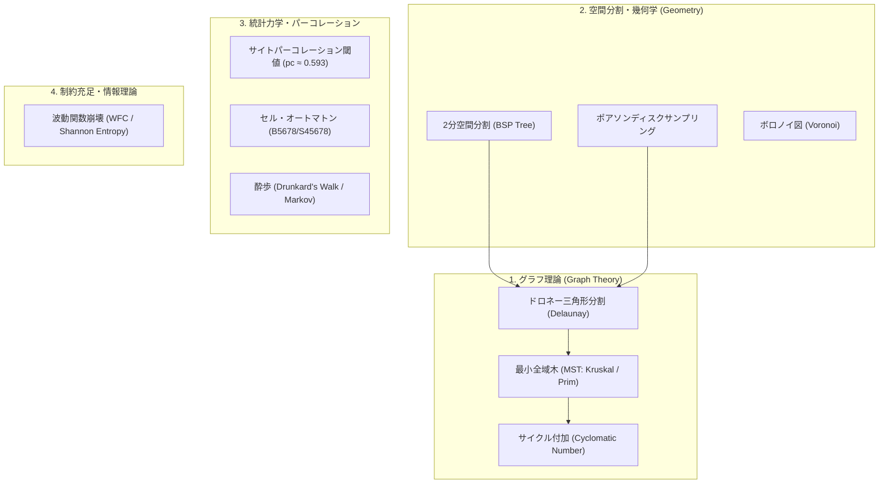

# ランダムダンジョン生成における数学的モデリングと仕様化検討レポート

本ドキュメントは、手続き型（プロシージャル）ダンジョン自動生成における **グラフ理論**、**離散幾何学**、**確率論・パーコレーション理論**、**制約充足問題 (CSP)** などの数学的基盤を体系的に調査し、次世代のダンジョン生成エンジンへの仕様化・設計指針をまとめた検討レポートです。

---

## 1. ダンジョンの数学的モデル化 (Mathematical Formulation)

ダンジョンは、離散数学および幾何学において主に以下の 2 つの抽象度でモデル化されます。

### 1.1 グリッド空間表現 (Grid Space: $\mathbb{Z}^2$)
マップを有限な 2 次元離散格子として定義します。
$$\mathcal{G} = \{ (x, y) \in \mathbb{Z}^2 \mid 0 \le x < W, \; 0 \le y < H \}$$
各セル $c \in \mathcal{G}$ は、状態空間 $S$ への写像を持ちます。
$$f: \mathcal{G} \to S, \quad S = \{ \text{Wall (■)}, \; \text{Floor (□)}, \; \text{Start (◆)}, \; \text{Door}, \; \text{Trap}, \; \dots \}$$

### 1.2 トポロジカル表現 (Topological Graph: $G = (V, E)$)
部屋と通路のトポロジー（接続構造）を有向/無向グラフとして定義します。
- **頂点集合 $V$**: 各部屋（または重要な分岐点・ジャンクション）
- **辺集合 $E$**: 部屋間を接続する通路（コリドー）
- **距離重み関数 $w: E \to \mathbb{R}^+$**: 通路の幾何学的長さ（マンハッタン距離 $L_1$ またはユークリッド距離 $L_2$）

---

## 2. 数学的アプローチの分類と理論的解析

ダンジョン生成に用いられる代表的な数学的アルゴリズムと理論を分類・解析します。



---

### 2.1 グラフ理論: ドロネー三角形分割と最小全域木 (MST)

ダンジョンに「孤立した部屋を作らず、かつ不自然な通路の交差を避ける」ための最も強力で美しい手法です。

#### 1. ドロネー三角形分割 (Delaunay Triangulation)
部屋の重心集合 $P = \{p_1, p_2, \dots, p_n\} \subset \mathbb{R}^2$ に対し、どの外接円も内部に他の点を含まない三角形分割を構成します。
- **計算量**: $O(n \log n)$
- **性質**: 近傍にある部屋同士のみに辺が張られ、平面グラフ（辺同士が交差しないグラフ）の候補が得られる。

#### 2. 最小全域木 (Minimum Spanning Tree: MST)
ドロネーグラフ $G_{\text{del}} = (V, E_{\text{del}})$ から、全頂点を連結しつつ総通路長 $\sum_{e \in E} w(e)$ を最小化する木 $T = (V, E_{\text{mst}})$ を抽出します（クラスカル法またはプリム法）。
$$|E_{\text{mst}}| = |V| - 1$$
- **性質**: これにより**全部屋の到達可能性（連結性）が数学的に 100% 保証**される。同時に、木構造であるためすべての通路が袋小路（行き止まり）または単一の分岐路となり、サイクル（周回経路）は存在しない。

#### 3. サイクル（周回路）の数学的付加: サイクロマティック数 (Cyclomatic Number)
ゲームプレイにおいて「一本道や完全な袋小路ばかりだと退屈」である場合、ドロネー辺のうち MST に選ばれなかった辺 $E_{\text{rem}} = E_{\text{del}} \setminus E_{\text{mst}}$ から、確率 $p_{\text{loop}} \in [0, 1]$ でランダムに辺を再追加します。
追加後のグラフ $G'$ の独立閉路数は、グラフ理論における**サイクロマティック数 (階数)** $M$ で厳密に定量化されます：
$$M = |E'| - |V| + 1$$
- $M = 0$: 完全な木構造（すべて袋小路・単一解）
- $M > 0$: $M$ 個の周回路・ループが存在し、プレイヤールートに選択肢と迂回路が生まれる。

---

### 2.2 幾何学・空間分割: BSP木 (Binary Space Partitioning Tree)

長方形ダンジョンを再帰的に超平面（水平/垂直線）で分割する空間データ構造です。

#### 数学的再帰構造
矩形領域 $R = [x_{\min}, x_{\max}] \times [y_{\min}, y_{\max}]$ に対し、分割線 $L$ を選定して 2 つの直和部分空間に分割：
$$R = R_{\text{left}} \cup R_{\text{right}}, \quad R_{\text{left}} \cap R_{\text{right}} = \emptyset$$
分割条件（停止性）：
$$\min(\text{width}(R), \text{height}(R)) < 2 \times \text{MIN\_ROOM\_SIZE}$$
木の葉ノード（Leaf Node）に部屋を 1 つずつ内包させ、親ノードを遡りながら隣接する部分空間同士を通路で結ぶことで、**部屋同士が絶対に重ならず、自然に階層化されたマップ**を生成できます。

---

### 2.3 確率論・統計力学: パーコレーション理論とセル・オートマトン

自然な洞窟や有機的な空洞を生成する場合、統計物理学のモデルが極めて有効です。

#### 1. サイトパーコレーション閾値 (Site Percolation Threshold)
正方格子において各セルを確率 $p$ で独立に床（空洞）にした場合、無限大のクラスタ（全体を貫通する巨大連結成分）が出現する臨界確率 $p_c$ が存在します：
$$p_c \approx 0.592746$$
- $p < p_c$: 空洞は微小な孤立島に分断され、探索不能。
- $p > p_c$: 巨大な大空洞が発生。ダンジョンとしては広大すぎて迷路性が失われる。
したがって、初期ランダム密度は $p \approx 0.40 \sim 0.48$ 付近に設定するのが工学的に最適です。

#### 2. セル・オートマトン (Cellular Automata) による平滑化
初期ランダム配置に対し、近傍 8 セルを用いた局所遷移規則（ライフゲーム類似）を $K$ ステップ適用します：
$$S^{(t+1)}(x, y) = \begin{cases}
\text{Wall} & \text{if } N_{\text{wall}}^{(t)}(x, y) \ge 5 \\
\text{Floor} & \text{otherwise}
\end{cases}$$
ここで $N_{\text{wall}}(x, y) = \sum_{dx=-1}^1 \sum_{dy=-1}^1 \mathbb{I}(f(x+dx, y+dy) = \text{Wall})$。
これにより、ノイズ状のセルが結合し、自然な岩肌と洞窟通路が自己組織化されます。

---

### 2.4 確率過程: 酔歩 (Drunkard's Walk / Random Walk)

原点 $(x_0, y_0)$ からスタートし、離散マルコフ連鎖に従ってランダムに四方に移動しながらセルを床として掘削する手法です。

#### 数学的性質
時刻 $t$ における位置 $X_t = X_{t-1} + \Delta X_t$ （ここで $P(\Delta X_t = (\pm 1, 0)) = P(\Delta X_t = (0, \pm 1)) = \frac{1}{4}$）。
- **再帰性 (Polya's Recurrence Theorem)**: 2 次元酔歩は確率 1 で出発点に無限回戻る。
- **空間占有率の収束**: ステップ数 $T$ に対し、訪問した固有セルの期待値は $E[S_T] \sim \frac{\pi T}{\ln T}$ となり、時間とともに行き止まり（袋小路）と不規則な部屋が自然に融合したマップが形成される。

---

### 2.5 制約充足・情報理論: 波動関数崩壊 (Wave Function Collapse: WFC)

量子力学の観測モデルに着想を得たタイル張り・構造生成手法。

#### シャノンエントロピーによる崩壊順序の決定
各未確定セル $c \in \mathcal{G}$ の取りうる候補タイル集合 $T_c$ に対し、シャノンエントロピー $H(c)$ を計算：
$$H(c) = -\sum_{t \in T_c} p(t) \log_2 p(t)$$
1. **最小エントロピーの選択**: $H(c) > 0$ かつ最小のセル（最も選択肢が絞られているセル）を選択。
2. **崩壊 (Observation)**: 重み付き確率で 1 つのタイルに確定。
3. **波及 (Propagation)**: 隣接セルの候補集合から矛盾するタイルを除外。
- **性質**: タイル間の接続ルール（例: 「ドアの隣は通路でなければならない」等）を 100% 遵守した整合性のあるダンジョンが数学的拘束のもとで生成される。

---

## 3. ダンジョン複雑性の数学的評価指標 (Metrics)

生成されたダンジョンの品質や難易度を定量化するための数学的評価関数を定義します。

| 指標名 | 数式 / 定義 | 意味・ゲームプレイ上の価値 |
| :--- | :--- | :--- |
| **充填率 (Fill Ratio: $\rho$)** | $\rho = \frac{\sum \mathbb{I}(c = \text{Floor})}{W \times H}$ | マップ全体の広さ・開放感の指標（通常 $0.15 \sim 0.35$） |
| **デッドエンド率 (Dead-End Ratio)** | $R_{\text{dead}} = \frac{\sum \mathbb{I}(\deg(v) = 1)}{\|V\|}$ | 袋小路の割合。探索の迷い度・宝箱配置候補の多さ |
| **ループ度 (Cyclomatic Number: $M$)** | $M = \|E\| - \|V\| + 1$ | 迂回路・周回ルートの多さ（$M=0$ で純木構造） |
| **平均最短経路長 (ASPL)** | $L_{\text{avg}} = \frac{1}{\|V\|(\|V\|-1)} \sum_{u \neq v} d(u, v)$ | 部屋間の平均移動歩数・ダンジョンの実質的広さ |
| **迷宮径 (Diameter: $D$)** | $D = \max_{u, v} d(u, v)$ | スタートから最深部（ボス部屋）までの最大距離 |

---

## 4. 仕様化検討とアルゴリズム拡張設計

現行の `dungeon_generator.py`（単純矩形＋L字配線＋外周封鎖）から、数学的モデルを取り入れた次期バージョンへの設計案です。

### 4.1 推奨ハイブリッド・アーキテクチャ (BSP + Delaunay + MST)

```
[1. BSP空間分割] ---> 重なりのない部屋集合 V を配置
         │
         ▼
[2. Delaunay 三角形分割] ---> 近傍部屋を結ぶ平面グラフ候補 E_del を生成
         │
         ▼
[3. Kruskal 法 (MST)] ---> 最小全域木 E_mst を構築 (全連結・到達保証)
         │
         ▼
[4. サイクル確率付加] ---> ループ率 p_loop に応じて余分な辺を追加
         │
         ▼
[5. A* / マンハッタン配線] ---> 実際のグリッドに通路を掘削
         │
         ▼
[6. 袋小路ブランチ付加] ---> 葉ノードや通路から行き止まりを伸長
         │
         ▼
[7. 外周封鎖 & 最遠点配置] ---> 外周壁を保証し、スタート(◆)から最遠点にゴール(★)を配置
```

### 4.2 ゴール・ボス部屋配置の数学的最適化
スタート地点 $s \in V$ に対し、全対最短経路アルゴリズム（ダイクストラ法 / BFS）を実行：
$$\text{Goal} = \arg\max_{v \in V} d(s, v)$$
スタート地点から**グラフ理論上の距離が最も遠い頂点**を数学的に選出することで、自動的に「ダンジョンの最深部」が定まり、ボス部屋や下り階段として設定できます。

---

## 5. まとめ

1. **連結性の数学的保証**:
   - ランダム配置のみでは到達不能な部屋が生じるリスクがあるが、**ドロネー分割＋最小全域木 (MST)** を採用することで、数学的に 100% 全部屋が連結することを証明可能。
2. **迷路性と自由度の制御**:
   - **サイクロマティック数 $M$** をパラメータ化することで、「一本道（木構造）」から「複雑な周回迷路（多重ループ）」までを連続的に制御可能。
3. **最深部の自動導出**:
   - 最短経路探索（BFS / Dijkstra）の最遠点探索により、ストーリー上・ゲームプレイ上最適なスタート＆ゴール配置が自動的に定まる。
