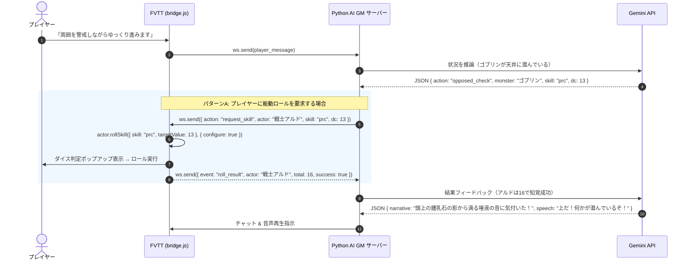

# Foundry VTT & D&D5e 制御仕様 調査レポート

本ドキュメントは、Foundry Virtual Tabletop (FVTT v11〜v14) および D&D 5th Edition システム (dnd5e v4〜v6) を対象に、AI GM (WebSocket 経由の自動制御) が操作可能な **シーン制御**、**マップ制御**、**トークン制御**、**ロール・判定制御** について API 仕様と実装コードを調査・整理したレポートです。

---

## 1. 調査対象と前提環境

- **Foundry VTT バージョン**: v11 〜 v14 (検証環境: v14.367+)
- **システム**: D&D 5th Edition (`dnd5e` v6.0.6, 日本語化: `dnd5eja`)
- **実行コンテキスト**: GM 権限を持つ FVTT クライアント内の JavaScript (`bridge.js`)

---

## 2. シーンの制御 (Scene Control)

シーン (`Scene`) は、FVTT のセッションにおけるマップや戦場、幕間画面を管理する最上位のドキュメントです。

### 2.1 シーンの検索と参照
```javascript
// 全シーンのコレクション
const allScenes = game.scenes.contents;

// IDによる取得
const scene = game.scenes.get("SceneID12345");

// シーン名（完全一致）による取得
const dungeonScene = game.scenes.getName("ゴブリンの洞窟 第1層");

// 現在画面に表示されているシーン (キャンバス上のシーン)
const currentScene = canvas.scene;
```

### 2.2 シーンの切り替え・遷移
AI GM の「プレイヤー全員を別の部屋やマップへ移動させる」「GMだけが先行して確認する」という挙動を制御できます。

```javascript
// 1. 全員を対象シーンに強制移動（シーンのアクティブ化）
await targetScene.activate();

// 2. GMの画面のみ当該シーンを表示・プレビュー（プレイヤーの画面は変えない）
await targetScene.view();
```

### 2.3 シーン設定の動的更新
```javascript
// ナビゲーションバーへの表示・非表示切り替え
await targetScene.update({ navigation: true });

// グリッドサイズ・単位の変更 (例: 1マス=5フィート)
await targetScene.update({
  grid: {
    size: 100,      // ピクセルサイズ
    distance: 5,    // 1マスの実距離
    units: "ft"     // 単位 ("ft", "m" など)
  }
});
```

### 2.4 シーンの新規作成・削除
```javascript
// シーンの動的生成
const newScene = await Scene.create({
  name: "謎の地下牢",
  background: { src: "worlds/the-antikythira/scenes/dungeon.webp" },
  grid: { size: 100, distance: 5, units: "ft" },
  navigation: false
});

// シーンの削除
await targetScene.delete();
```

---

## 3. マップ & キャンバスの制御 (Map & Canvas Control)

キャンバス (`canvas`) は、マップの描画、ライティング、天候、カメラ視点を司るグラフィック層です。

### 3.1 背景画像の切り替え (部屋の崩壊やフェーズ変化)
```javascript
// 現在のシーンの背景マップ画像を変更
await canvas.scene.update({
  background: { src: "maps/burned_temple.webp" }
});
```

### 3.2 カメラ（視点・ズーム）の制御 (Pan & Zoom)
特定の部屋や出現したモンスターへプレイヤーの注目を集める演出が可能です。

```javascript
// 指定座標 (x, y) へカメラをスムーズにパン＆ズーム
// scale: 1.0(通常), 1.5(拡大), duration: 移動ミリ秒
canvas.animatePan({
  x: 1200,
  y: 800,
  scale: 1.3,
  duration: 1200
});
```

### 3.3 環境光 (Darkness) と昼夜の切り替え
```javascript
// 暗さの変更 (0.0 = 真昼の太陽光, 1.0 = 真っ暗な深夜・洞窟)
await canvas.scene.update({ darkness: 0.85 });

// 全体光 (Global Illumination) の有効化 / 無効化
// 洞窟内などで松明・暗視のみで探索させたい場合は false
await canvas.scene.update({
  globalLight: { enabled: false }
});
```

### 3.4 天候エフェクト (Weather Effects)
FVTT 標準の天候パーティクルエフェクトを即座に適用・解除できます。

```javascript
// 雨を降らせる
await canvas.scene.update({ weather: "rain" });

// その他の標準エフェクト: "snow" (雪), "fog" (霧), "leaves" (落ち葉)
// 解除する場合は空文字を指定
await canvas.scene.update({ weather: "" });
```

### 3.5 フォグ・オブ・ウォー (Fog of War) の制御
```javascript
// プレイヤーの探索済みフォグ（視界記憶）をリセットして再探索させる
canvas.fog.reset();

// シーンのフォグ探索記録を有効化
await canvas.scene.update({
  fog: { exploration: true }
});
```

---

## 4. トークンの制御 (Token Control)

トークン (`Token` / `TokenDocument`) は、キャンバス上に配置されたキャラクターやモンスターの実体です。

### 4.1 トークンの検索・取得
```javascript
// キャンバス上に配置されている全トークン
const tokens = canvas.tokens.placeables;

// トークン名から特定
const goblinToken = tokens.find(t => t.name === "ゴブリン1");

// トークンIDから取得
const token = canvas.tokens.get("TokenID123");
```

### 4.2 モンスターのスポーン (新規配置)
ワールドのアクター一覧 (`game.actors`) からトークンデータを生成し、マップの指定座標に出現させます。

```javascript
// 1. ワールド内のアクターを取得
const actor = game.actors.getName("ゴブリン");

if (actor) {
  // 2. トークンドキュメントの初期データを生成
  const tokenDocData = await actor.getTokenDocument({
    x: 1500,
    y: 1000,
    elevation: 0,
    hidden: false // 出現時からプレイヤーに見せるか
  });

  // 3. 現在のシーンに埋め込みドキュメントとして作成
  const [createdToken] = await canvas.scene.createEmbeddedDocuments("Token", [tokenDocData]);
  console.log("トークン生成完了:", createdToken.name);
}
```

### 4.3 トークンの移動と回転
```javascript
// アニメーション付きで指定座標に移動
await token.document.update({
  x: 1800,
  y: 1200
}, { animate: true });

// 向き（角度 0〜360度）を変更
await token.document.update({ rotation: 180 });
```

### 4.4 不可視化・出現演出 (潜伏モンスター)
```javascript
// プレイヤーから見えない状態（半透明のGM専用表示）にする
await token.document.update({ hidden: true });

// 姿を現す
await token.document.update({ hidden: false });
```

### 4.5 視界 (Vision) と光源 (Light) の設定
```javascript
// 暗視 (Darkvision 60ft) の付与
await token.document.update({
  sight: {
    enabled: true,
    range: 60,
    visionMode: "darkvision"
  }
});

// 松明を持たせる（周囲40ftを照らすオレンジ色の光）
await token.document.update({
  light: {
    bright: 20,
    dim: 40,
    color: "#ff9900",
    alpha: 0.45,
    animation: { type: "torch", speed: 5, intensity: 5 }
  }
});
```

### 4.6 HP の更新と状態異常 (Conditions / Status Effects)
```javascript
// HP の変動 (現在HPを15に設定)
await token.actor.update({ "system.attributes.hp.value": 15 });

// 状態異常アイコンのトグル付与/解除
// 主なID: "blind" (盲目), "invisible" (不可視), "prone" (伏せ), "poison" (毒), "stun" (気絶)
await token.toggleEffect("invisible");
```

---

## 5. ロール・判定の制御 (D&D5e システム特化)

D&D5e におけるスキルの判定（モンスターに感づくか等の知覚チェック）は、**受動判定 (Passive Score)** と **能動判定 (Active Roll)** の2通りのアプローチが存在します。

### 5.1 D&D5e スキルキー一覧

| キー | 英語名 | 日本語名 | 主能力値 | 用途の例 |
| :--- | :--- | :--- | :--- | :--- |
| **`prc`** | **Perception** | **知覚** | `wis` (判断力) | **敵の潜伏、隠し扉、環境音に気づくか** |
| **`ste`** | **Stealth** | **隠密** | `dex` (敏捷力) | **敵に気づかれずに行動・接近する** |
| **`inv`** | **Investigation** | **捜査** | `int` (知力) | 書斎をくまなく調べる、罠の構造を見抜く |
| **`ins`** | **Insight** | **看破** | `wis` (判断力) | NPC の嘘や心理、動機を察する |
| **`ath`** | **Athletics** | **運動** | `str` (筋力) | 崖を登る、扉を突き破る、水泳 |
| **`acr`** | **Acrobatics** | **曲芸** | `dex` (敏捷力) | 細い橋の横断、宙返り、バランス維持 |
| **`sur`** | **Survival** | **生存** | `wis` (判断力) | 足跡の追跡、道迷い防止、野営地確保 |
| **`slt`** | **Sleight of Hand** | **手先の早業**| `dex` (敏捷力) | スリ、鍵開け補助、手品の演出 |

---

### 5.2 受動的判定 (Passive Perception) による自動判定
プレイヤーにダイスを振らせず、モンスターの隠密ロール結果と直接比較して「自動的に気づいたか」を判定するアプローチです。

```javascript
const pcActor = game.actors.getName("戦士アルド");

// アルドの受動知覚値を取得 (例: 10 + 判断力修正値 + 習熟 = 14)
const passivePerception = pcActor.system.skills.prc.passive;
console.log("アルドの受動知覚:", passivePerception);

// モンスターの隠密判定 (DC = stealthRoll.total) と比較
if (monsterStealthTotal <= passivePerception) {
  // プレイヤーは物音や気配に無意識のうちに気づいた
} else {
  // モンスターは気付かれずに不意打ち可能
}
```

---

### 5.3 能動スキルロール API (`actor.rollSkill`)
D&D5e システム (`dnd5e` v4〜v6) でプレイヤーにスキル判定を行わせる標準 API です。

#### 基本呼び出し (ダイアログあり / なし)
```javascript
const actor = game.actors.getName("戦士アルド");

// 1. ダイアログをスキップして即座にダイスロール (Fast Forward)
const rolls = await actor.rollSkill(
  {
    skill: "prc",          // 知覚 (Perception)
    targetValue: 15        // 目標DC (任意: 成功/失敗判定がチャットに付与される)
  },
  {
    configure: false       // ダイアログ非表示（即時実行）
  },
  {
    create: true           // チャット欄に結果カードを投稿
  }
);

if (rolls && rolls.length > 0) {
  const total = rolls[0].total;      // 合計値 (d20 + 修正値)
  const isSuccess = total >= 15;     // 目標値に対する成否
  console.log(`判定結果: ${total} (成功: ${isSuccess})`);
}
```

#### 有利 / 不利 (Advantage / Disadvantage) の指定
```javascript
// 周囲が暗闇や濃霧で不利な場合
await actor.rollSkill(
  { skill: "prc", disadvantage: true },
  { configure: false }
);

// 高い見張り台から見下ろしており有利な場合
await actor.rollSkill(
  { skill: "prc", advantage: true },
  { configure: false }
);
```

#### シークレットロール (Blind GM Roll)
プレイヤーには出目を見せず、GM画面にのみ結果を通知する設定：
```javascript
await actor.rollSkill(
  { skill: "prc" },
  { configure: false },
  { data: { rollMode: "blindroll" } }
);
```

---

### 5.4 能力値判定 (`rollAbilityCheck`) & セーヴィングスロー (`rollSavingThrow`)

```javascript
// 判断力 (Wisdom) 能力値判定
await actor.rollAbilityCheck(
  { ability: "wis" },
  { configure: false }
);

// 敏捷力 (Dexterity) セーヴィングスロー (罠やブレス攻撃回避)
await actor.rollSavingThrow(
  { ability: "dex", targetValue: 14 },
  { configure: false }
);
```

---

### 5.5 具体例: 「モンスターの気配に感づくか」の完全対抗シーケンス



#### ロール結果検知フック (`bridge.js` 側)
D&D5e システムはスキルロール完了時に `dnd5e.rollSkill` フックを発火します。
```javascript
Hooks.on("dnd5e.rollSkill", (rolls, data) => {
  // data: { ability: "wis", skill: "prc", subject: Actor5e }
  if (!rolls || !rolls.length) return;

  const roll = rolls[0];
  console.log(`[D&D5e ロール検知] ${data.subject.name} の ${data.skill} 判定: ${roll.total}`);

  // バックエンドへ判定結果を送信
  ws.send(JSON.stringify({
    event: "skill_roll_result",
    actor: data.subject.name,
    skill: data.skill,
    total: roll.total,
    formula: roll.formula
  }));
});
```

---

## 6. AI GM Bridge へのプロトコル拡張設計案

本調査結果に基づき、今後 `ai-gm-bridge` がインゲーム制御をサポートするための WebSocket メッセージ仕様の拡張案を定義します。

### 6.1 サーバー → FVTT (実行指示)

#### 1. シーン制御 (`change_scene`)
```json
{
  "action": "change_scene",
  "scene_name": "地下迷宮 第2層",
  "activate": true
}
```

#### 2. マップ演出制御 (`update_map`)
```json
{
  "action": "update_map",
  "darkness": 0.8,
  "weather": "rain",
  "pan_to": { "x": 1400, "y": 900, "scale": 1.2 }
}
```

#### 3. モンスター・トークン出現 (`spawn_token`)
```json
{
  "action": "spawn_token",
  "actor_name": "ゴブリン斥候",
  "x": 1400,
  "y": 900,
  "hidden": false
}
```

#### 4. D&D5e スキルロール要求 (`request_skill`)
```json
{
  "action": "request_skill",
  "actor_name": "戦士アルド",
  "skill": "prc",
  "target_dc": 14,
  "fast_forward": false
}
```

---

### 6.2 FVTT → サーバー (結果フィードバック)

#### スキル判定結果通知 (`skill_roll_result`)
```json
{
  "event": "skill_roll_result",
  "actor": "戦士アルド",
  "skill": "prc",
  "total": 17,
  "target_dc": 14,
  "success": true
}
```

---

## 7. 調査まとめと実装推奨手順

1. **第1ステップ（即時導入可能）: ロールの自動化とフック検知**
   - 既存の `bridge.js` に `dnd5e.rollSkill` フックを追加し、プレイヤーの「知覚」「隠密」などのダイス結果を Python サーバーへ自動フィードバックできるようにする。
2. **第2ステップ: カメラパンとマップ演出**
   - `canvas.animatePan` および `canvas.scene.update({ darkness, weather })` は安全かつ簡単に導入でき、AI の情景描写と連動して没入感を劇的に高められる。
3. **第3ステップ: トークンの自動配置・移動**
   - 戦闘遭遇時やイベント発生時に、あらかじめ用意されたアクター（モンスター）を `createEmbeddedDocuments("Token", ...)` で自動召喚・配置する。
