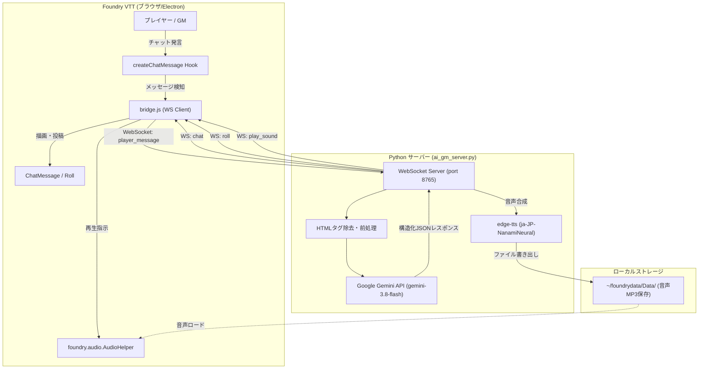
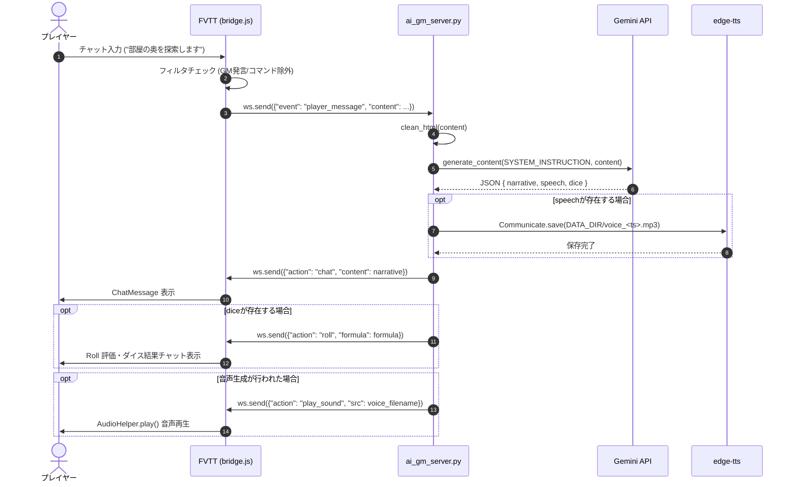

# AI GM Bridge システム仕様書

## 1. 基本情報

- **システム名称**: AI GM Bridge
- **モジュールID**: `ai-gm-bridge`
- **対象環境**:
  - Foundry Virtual Tabletop (FVTT): v11 〜 v14
  - Python: 3.12+ (現行環境: 3.14)
  - OS: Linux / WSL / macOS
- **目的**: Foundry VTT 上で動作するセッションにおいて、LLM (Google Gemini) を自律型ゲームマスター (AI GM) として組み込み、プレイヤーの発言に応じた情景描写、ダイス判定指示、音声合成による発話演出を自動で行う。

---

## 2. システム構成・アーキテクチャ

本システムは、FVTT 内で動作するクライアントモジュールと、外部で動作する Python WebSocket バックエンドサーバーの 2 層構成です。



---

## 3. コンポーネント仕様

### 3.1 Foundry VTT モジュール側

| ファイル | 種別 | 説明 |
| :--- | :--- | :--- |
| [`module.json`](file:///home/kenic/foundrydata/Data/modules/ai-gm-bridge/module.json) | マニフェスト | モジュールメタデータ、対応バージョン、エントリーポイント定義 |
| [`bridge.js`](file:///home/kenic/foundrydata/Data/modules/ai-gm-bridge/bridge.js) | ESModule | WebSocket クライアント、FVTT API フック、イベントディスパッチャ |

#### 動作要件・権限設計
- **GM 権限限定実行**:
  - `game.user.isGM` が `true` のクライアントのみ WebSocket 接続を開設。
  - 一般プレイヤーのクライアントがサーバーと通信することによる重複実行や無駄な負荷を防止。
- **再接続機能**:
  - 切断時 (`onclose`) は 5 秒間隔で自動再試行。
- **オーディオコンテキスト自動復帰**:
  - ブラウザの自動再生ポリシーによるサスペンド状態 (`game.audio.context.state === "suspended"`) を検知し、再生直前に `resume()` を実行。

#### フック処理 (`createChatMessage`)
- **発言フィルタリング**:
  - ループ防止: 送信者のエイリアスが `AI GM` で始まる場合は送信除外。
  - コマンド除外: 先頭が `/` (スラッシュコマンド) や `[` (マクロ等) で始まるメッセージは除外。
  - 通常のプレイヤー会話のみを抽出してサーバーに転送。
- **送り先の切り替え (NPC 会話)**: 発言者のトークン (`message.speaker.token`、無ければ発言ユーザーのキャラクターのトークン) から
  35ft 以内で、壁で音が遮られていない NPC (character 以外・プレイヤー非所有・非表示でない) がいれば `npc_dialogue_request`、
  いなければ `player_message` を送る。どちらか 1 経路だけ (二重応答を防ぐ)。発言者のトークンが分からないときは `player_message`。

#### フック処理 (`combatTurnChange` / `updateCombat`)
- **NPC の自律戦闘**: 戦闘トラッカーで手番が NPC (character 以外・プレイヤー非所有・非表示でない・HP 0 や戦闘不能・行動不能の状態でない) に
  回ったら、その NPC の知覚を集めて `npc_turn_request` を送る。同じ手番には 1 回だけ (v12 以降の `combatTurnChange` と v11 の `updateCombat` の両方で拾う)。
- 設定「NPC の自律戦闘」(ワールド設定、既定は有効) で止められる。
- AI が動かしている NPC のアイテムのカードなどは、発言として `player_message` / `npc_dialogue_request` に回さない。

---

### 3.2 Python バックエンドサーバー側

| ファイル | 役割 |
| :--- | :--- |
| [`ai_gm_server.py`](file:///home/kenic/foundrydata/Data/modules/ai-gm-bridge/ai_gm_server.py) | メイン WebSocket サーバー。Gemini API 呼び出し、edge-tts 音声合成、FVTT へのメッセージ配信 |
| [`tools/test_send.py`](file:///home/kenic/foundrydata/Data/modules/ai-gm-bridge/tools/test_send.py) | チャット・ダイス音送信の単体疎通テスト用スクリプト |
| [`tools/test_voice.py`](file:///home/kenic/foundrydata/Data/modules/ai-gm-bridge/tools/test_voice.py) | 音声生成と FVTT 再生指示の単体疎通テスト用スクリプト |

#### 使用技術・ライブラリ
- **WebSocket**: `websockets` (ポート: `8765`, ホスト: `0.0.0.0`)
- **LLM**: `google-genai` (モデル: `gemini-3.8-flash`)
- **TTS**: `edge-tts` (ボイスモデル: `ja-JP-NanamiNeural`)。`AI_GM_TTS_ENGINE=irodori` で Irodori-TTS-Server (OpenAI 互換 API) に切り替えられる。Irodori で作れないときは edge-tts で作り直し、その後 `AI_GM_IRODORI_RETRY_AFTER` 秒は edge-tts だけを使う (切り替わった最初の 1 回だけ GM の画面に `progress` で知らせる)。起動時に `/health` で繋がるかを確かめて表示する。入れ方は [`irodori_tts_setup.md`](irodori_tts_setup.md)

#### エラーハンドリング & レジリエンス
- **HTML クリーニング**: FVTT チャットに含まれる `<p>...</p>` などの HTML タグを正規表現で事前除去。
- **API 再試行 (Exponential Backoff)**: Gemini API が 503 過負荷を返した場合、最大 3 回まで指数関数的待機時間（2秒、4秒）を設けて自動再試行。
- **agy の呼び出し**: `agy -p <プロンプト> --output-format json` に、`--model` (`AI_GM_AGY_MODEL`、既定 `gemini-3.8-flash-medium`。空文字にすると付けない)、`AI_GM_AGY_EFFORT` があれば `--effort` を付ける。
  agy は同時に複数起動すると応答が返らなくなることがあるため、同時実行は `AI_GM_AGY_CONCURRENCY` (既定 1) 本まで。分割した問い合わせも 1 本ずつ順番に投げる。
  - agy は空の作業フォルダ (`AI_GM_AGY_WORKDIR`、既定 `~/ai-gm-logs/agy-workspace`) で動かす。agy はエージェントなので、モジュールのソースがあるフォルダで動かすとファイルを読み回ることがある。
  - stdin はつながない (確認の入力を待ってサーバーの端末を読みに行かないように)。
  - agy は結果を出し終えたあと、プロセスが終了せずに残ることがある。標準出力に結果の JSON がそろった時点で受け取り、3 秒待っても終わらなければ止める。
  - 応答が止まったときの調査用に、agy 自身の動作ログを `--log-file` で今日のログフォルダ (`agy-<時刻>-<番号>.log`) に残す (`AI_GM_AGY_LOG=0` で止める)。
    実行中は 30 秒ごとにプロセスの状態・CPU 時間・子プロセスと出力の量を、標準エラー出力は届いた行ごとに詳細ログへ書く。打ち切ったときはそれまでの出力も残す。
- **詳細ログ**: 下の「ログ」を参照。
- **再接続をまたぐ送信**: 処理中に依頼元の接続が閉じたら (FVTT の再読み込みなど)、いま繋がっている接続へ送る。
  どこにも繋がっていなければ最大 20 件まで溜め、次の接続時に送る (`progress` は溜めない)。`gm_server/context.py` の `ConnectionHub`。

#### ログ

サーバーの動きはコンソールと詳細ログファイルの両方に出します (`gm_server/logs.py`・`gm_server/progress.py`)。

**置き場所と残し方**

```text
~/ai-gm-logs/                      # AI_GM_LOG_DIR。FVTT はモジュールフォルダを Web で配信するため Data フォルダの外に置く
├── 2026-10-17/                    # 日付フォルダ。日付が変わると新しいフォルダに切り替える
│   ├── server.log                 # 詳細ログ (20MB を超えたら server.log.1 … server.log.20 に回す)
│   └── agy-002510-0001.log        # agy 自身の動作ログ (agy-<時刻>-<番号>.log。AI_GM_AGY_LOG=0 で出さない)
└── agy-workspace/                 # agy を動かす空のフォルダ (ログではない)
```

- 今日を含めて 10 日 (`AI_GM_LOG_DAYS`) より古い日付フォルダは、起動時と日付が変わったときに削除する。
- 各行に「日時 レベル」(INFO / WARNING / ERROR) を付ける。コンソールも同じ形。
- `GEMINI_API_KEY` と、名前に KEY / TOKEN / SECRET / PASSWORD を含む環境変数の値、Google API キーの形の文字列は `***` に伏せる (ファイルにもコンソールにも出さない)。

**グループ分け (全体 → 工程 → 細かい作業)**

時間のかかる処理は 3 段に分けて出します。

| 印 | 段 | 例 |
| :--- | :--- | :--- |
| `■` | 全体の処理の始まりと終わり | `■ シナリオビルダー: 地下迷宮『塔』のシーンを構築します (AI、small、seed=8)` / `■ … シーン構築を終えました (95秒)` |
| `  ▶` | 全体の中の工程 | `  ▶ [1/2 マップ生成] マップを作りました (24 区画、壁 310 本、画像 …)` / `  ▶ [ビルダー: 集落 1/2 骨組み] AI に問い合わせます (プロンプト 5200 文字、上限 300秒)` |
| `    ・` | 工程の中の細かい作業 | `    ・[区画の情景] 区画 3・5・8・12 の情景を作成中 (12 区画中 4 区画済み)` / `    ・区画 3・5・8・12 の情景をシーンに反映しました (8/12 区画)` |

待ちの長い工程の間は、コンソールの最後の行を 1 秒ごとに書き換えて `[ラベル] いまの作業 / 経過 / タイムアウトまで残り` を出します (詳細ログには書かない)。
FVTT のビルダー画面にも同じ内容を 2 行で出します (`builder_progress`。1 行目が全体、2 行目がいまの作業)。

**詳細ログだけに書くもの**

- AI への問い合わせ: エンジン・モデル・agy のコマンド・プロンプト全文。`[AI #番号]` を付け、応答と突き合わせられるようにする。
- AI の応答: 全文・所要時間・終了コード。失敗・打ち切りのときはそれまでの出力。
- agy の様子: 標準エラー出力の各行と、30 秒ごとのプロセスの状態 (CPU 時間・子プロセス・出力の量)。結果を出したのに終わらないときは「終了しないため止めました」。
- FVTT との送受信 (「受信」「送信」。4000 文字まで。`builder_progress` と `progress` は書かない)。

**困ったときの見方**

1. コンソールで `■` の行を探し、どの処理で止まったかを見る。
2. その下の `▶` と `・` で、どの工程・どの区画までできたかを見る。
3. AI の問題なら、`server.log` で同じ `[AI #番号]` の問い合わせと応答を見る。agy なら同じ時刻の `agy-*.log` も見る。

#### 環境変数

すべて省略できます (既定値で動きます)。定義は `gm_server/config.py`。サーバーを起動する端末で `export 名前=値` してから `python3 ai_gm_server.py` を実行します。

| 環境変数 | 既定値 | 内容 |
| :--- | :--- | :--- |
| `GEMINI_API_KEY` | (なし) | Gemini API のキー。設定すると Gemini を直接使い、無ければ agy CLI を使う。ログには `***` で伏せて書く |
| `AI_GM_GEMINI_MODEL` | `gemini-3.8-flash` | Gemini を直接使うときのモデル |
| `AI_GM_GEMINI_TIMEOUT` | `120` | Gemini の 1 回の問い合わせの待ち上限 (秒) |
| `AI_GM_LLM_CONCURRENCY` | `3` | Gemini に同時に投げる問い合わせの数 (部屋の情景などの分割分) |
| `AI_GM_AGY_MODEL` | `gemini-3.8-flash-medium` | agy に `--model` で渡すモデル (`agy models` で一覧)。空文字にすると `--model` を付けず agy 自身の既定を使う |
| `AI_GM_AGY_EFFORT` | (なし) | agy に `--effort` で渡す推論の深さ (low / medium / high / xhigh / max) |
| `AI_GM_AGY_TIMEOUT` | `300` | agy の 1 回の問い合わせの待ち上限 (秒)。過ぎると延長の確認カードを出す |
| `AI_GM_AGY_CONCURRENCY` | `1` | agy を同時に動かす数。2 以上にすると応答が返らなくなることがある |
| `AI_GM_AGY_WORKDIR` | `~/ai-gm-logs/agy-workspace` | agy を動かす空のフォルダ |
| `AI_GM_AGY_LOG` | `1` | `0` で agy 自身の動作ログ (`agy-<時刻>-<番号>.log`) を残さない |
| `AI_GM_MAPGEN_TIMEOUT` | `300` | マップ生成の待ち上限 (秒) |
| `AI_GM_DATA_DIR` | `~/foundrydata/Data` | FVTT の Data フォルダ。マップ画像と音声をここに書き出す |
| `AI_GM_TTS_ENGINE` | `edge` | 音声エンジン。`edge` (edge-tts) か `irodori` (Irodori-TTS-Server。繋がらないときは edge-tts に戻す) |
| `AI_GM_IRODORI_URL` | `http://127.0.0.1:8088` | Irodori-TTS-Server の URL |
| `AI_GM_IRODORI_MODEL` | `irodori-tts` | `/v1/audio/speech` に渡すモデル名 (サーバーの `IRODORI_MODEL_NAME`) |
| `AI_GM_IRODORI_VOICE` | `none` | 参照音声の ID (サーバーの voices フォルダのファイル名)。`none` なら声の説明文だけで作る |
| `AI_GM_IRODORI_API_KEY` | (なし) | Irodori-TTS-Server を `IRODORI_API_KEY` 付きで起動したときの同じ値。ログには `***` で伏せて書く |
| `AI_GM_IRODORI_TIMEOUT` | `20` | Irodori の 1 回の音声生成の待ち上限 (秒)。描写のチャットは音声ができてから送るため短めにする |
| `AI_GM_IRODORI_FIRST_TIMEOUT` | `180` | 最初の 1 回の待ち上限 (秒)。最初の音声生成でモデルを読み込むため長めにする |
| `AI_GM_IRODORI_HEALTH_TIMEOUT` | `5` | 起動時に `/health` を確かめるときの待ち上限 (秒) |
| `AI_GM_IRODORI_RETRY_AFTER` | `60` | Irodori に失敗したあと edge-tts だけを使う時間 (秒) |
| `AI_GM_IRODORI_CAPTION_FEMALE` | 落ち着いた大人の女性の声。… | ナレーションと女性の NPC (ボイスが Keita 以外) の声の説明文 (VoiceDesign) |
| `AI_GM_IRODORI_CAPTION_MALE` | 落ち着いた大人の男性の声。… | 男性の NPC (ボイスが Keita) の声の説明文 |
| `AI_GM_HOST` | `0.0.0.0` | WebSocket サーバーの待ち受けアドレス |
| `AI_GM_PORT` | `8765` | WebSocket サーバーのポート |
| `AI_GM_LOG_DIR` | `~/ai-gm-logs` | 詳細ログの出力先 (日付フォルダを作る) |
| `AI_GM_LOG_DAYS` | `10` | 詳細ログを残す日数 (今日を含む) |
| `AI_GM_LOG_MAX_BYTES` | `20971520` (20MB) | 1 日分のログファイルの上限。超えたら `server.log.1` … に回す |

---

## 4. 通信プロトコル & データフォーマット

### 4.1 FVTT → Python サーバー

#### プレイヤー発言イベント (`player_message`)
プレイヤーが FVTT チャット欄に通常発言を行った際に送信されます。

```json
{
  "event": "player_message",
  "user": "string (発言プレイヤーの表示名)",
  "content": "string (発言テキスト本文)"
}
```

#### NPC 会話イベント (`npc_dialogue_request`)
発言者の声が届く NPC (近い順に最大 4 人) がいるときに、`player_message` の代わりに送ります。NPC の知識・秘密・記憶は actor の flag `npc_brain` (`/ai NPC` の画面で編集)。

```json
{
  "event": "npc_dialogue_request",
  "speaker_name": "アリア", "speaker_token_id": "トークン id", "scene_id": "シーン id",
  "player_input": "帳簿を見せてくれ",
  "room_name": "発言者がいる部屋 (部屋の外ならシーン名)", "room_flavor": "部屋の情景",
  "check_result_context": null,
  "listening_npcs": [{
    "id": "トークン id", "name": "エドガー", "distance_ft": 5,
    "goal": "…", "trust": 0, "public_known": "…", "secret_known": "…", "ignorance": "…",
    "short_term_memory": ["…"], "long_term_memory": ["[うろ覚え] (重要度:4) …"],
    "voice": { "name": "ja-JP-KeitaNeural", "rate": "+0%", "pitch": "+0Hz" }
  }]
}
```

判定ボタンで振った結果を受けたときは、`check_result_context` に「説得判定 成功 (出目の合計 16 / 目標値 14)。打ち明けてよい内容: …」を入れて同じ形で送ります
(ヒントと目標値は GM のクライアントが覚えている値を使い、プレイヤー側の値は使いません)。

#### NPC の手番イベント (`npc_turn_request`)
戦闘で NPC の手番になったときに送ります。`combat` は頼んだときの手番で、サーバーはそのまま `execute_npc_turn` に付けて返します。

```json
{
  "event": "npc_turn_request", "scene_id": "戦闘のシーン id",
  "combat": { "id": "戦闘 id", "round": 2, "turn": 3 },
  "perception": {
    "token_id": "手番の NPC のトークン id", "npc_name": "オークの戦士", "npc_role": "humanoid",
    "npc_bio": "伝記 (HTML を除いて 300 文字まで)", "npc_goal": "npc_brain の目的",
    "hp_current": 4, "hp_max": 15, "health_status": "健在・余裕あり | 負傷・消耗 | 瀕死・危機的 | 倒れている",
    "move_speed": 30, "available_actions": [{ "name": "グレートアックス", "type": "weapon | feat | spell" }],
    "room_name": "NPC がいる部屋 (部屋の外ならシーン名)", "room_flavor": "…", "room_gm_notes": "…",
    "perceived_targets": [{ "token_id": "…", "name": "アリア", "distance_ft": 5, "adjacent": true,
                            "has_los": true, "health_status": "…" }],
    "voice": { "name": "ja-JP-KeitaNeural", "rate": "+0%", "pitch": "+0Hz" }
  }
}
```

- 距離は 5e の数え方 (斜めも 1 マス) で、大きいトークンは端どうし。`has_los` は戦闘のシーンをキャンバスに表示しているときだけ判定し、それ以外は `null`。

#### GM `/ai` コマンドイベント (`ai_command`)
GM がチャット欄で `/ai <プロンプト>` を実行した際に送信されます。

```json
{
  "event": "ai_command",
  "user": "string (GM表示名)",
  "prompt": "string (AIへの指示内容)"
}
```

#### チャット内ボタン選択イベント (`ai_choice`)
GM が対話型チャットカード上の選択肢ボタンをクリックした際に送信されます。

```json
{
  "event": "ai_choice",
  "user": "string (GM表示名)",
  "value": "string (選択肢の内部識別値。例: 'dungeon_size:small')",
  "label": "string (選択肢の表示名。例: '小 (100x100マス)')"
}
```

#### シナリオビルダー (`builder_generate_stage` / `builder_build_scene`)
`/ai ビルダー` で開く画面から送信します。詳細は [scenario_builder_spec.md](scenario_builder_spec.md)。

```json
{
  "event": "builder_generate_stage",
  "stage": "region | settlement | wilderness | site_lore",
  "user_prompt": "GM 指示",
  "fixed_name": "GM が付けた名前 (無ければ空)",
  "world": { "title": "…", "description": "…", "references": [{ "name": "参照ジャーナル", "text": "…" }] },
  "parents": [{ "category": "region", "name": "…", "public_lore": "…", "dm_secrets": "…", "canon": ["…"], "open_threads": ["…"] }],
  "atlas_index": [{ "category": "settlement", "name": "…", "canon": ["…"] }],
  "actor_names": ["…"],
  "recent_cards": ["region.terrain.salt_flat"],
  "settlement_scale": "(settlement のみ)",
  "site_mode": "(site_lore のみ) ruins | underground", "size_key": "small | medium",
  "actors_context": { "pcs": [{ "name": "…", "info": "…", "bio": "…" }], "npcs": [] }
}
```

`builder_build_scene` は上記の文脈に加えて `scene_mode`, `name`, `public_lore`, `dm_secrets` を送ります。
旅路は `map` (`{"seed": …}`) と `landmarks`、遺跡は `size_key` (small / medium)・`density`・`loop_ratio`・`sub_objectives` を送ります。
サーバーは `create_dungeon_scene` で応答します。
遺跡は、ジェネレータ (`tools/dungeon_generator.py`) で地図・壁・区画を作った時点で仮の区画名のまま `scene_key` 付きの `create_dungeon_scene` を送り、
AI が区画の情景を書き終えたものから `update_dungeon_rooms` で差し替えます (AI の応答を待たずにシーンを開けます)。

`builder_build_scene` の `use_ai` (bool、既定 true) が false なら「スクリプト」で構築します。AI には問い合わせず、ジェネレータの地図と仮の区画名のままシーンを作って終えます
(旅路は下書きのランドマークも使いません。区画の文面は DM が探索録に書きます)。

`builder_generate_stage` と `builder_build_scene` は `auto_extend` (bool。ビルダー画面の「⏱️ タイムアウトしたら自動で延長する」、既定 false) を送ります。
true のときはタイムアウトしても GM に確認せず、同じ秒数だけ自動で延長します (最大 5 回。それ以降は通常どおりカードで確認します)。

集落と旅路の下書きは、AI の応答が長くタイムアウトしやすいため 2 回に分けて問い合わせます
(集落: 骨組み → 人物と秘密、旅路: 骨組みと地点の一覧 → 地点の描写を 5 地点ずつ。Gemini は並列、agy は 1 本ずつ)。FVTT に返す `builder_stage_result` の形は 1 回のときと同じです。

---

### 4.2 Python サーバー → FVTT

サーバーは Gemini の推論結果および音声合成の完了に応じて、以下のアクションメッセージを順次送信します。

#### 1. チャット描写 (`chat`)
情景描写やセリフを FVTT のチャットログに投稿します。

```json
{
  "action": "chat",
  "speaker": "string (表示名。既定値: 'AI GM')",
  "content": "string (チャット本文。リッチテキスト可)"
}
```

#### 2. ダイスロール (`roll`)
判定が必要な場合にダイスコマンドを実行させます。

```json
{
  "action": "roll",
  "speaker": "string (表示名。既定値: 'AI GM (判定)')",
  "formula": "string (ダイス計算式。例: '1d20', '2d6+3')"
}
```
※ サーバー側で `/r ` や `/roll ` プレフィックスを自動除去して送信します。

#### 3. 音声再生 (`play_sound`)
合成した音声ファイルまたはシステム効果音の再生を指示します。

```json
{
  "action": "play_sound",
  "src": "string (Dataディレクトリからの相対パス。例: 'voice_1728712345.mp3')",
  "volume": "number (音量 0.0〜1.0。既定値: 1.0)"
}
```

#### 4. インタラクティブ選択カード (`interactive_card`)
GM 向けに対話型の選択肢ボタンを含むチャットカードを表示します。

```json
{
  "action": "interactive_card",
  "title": "ダンジョン自動生成",
  "message": "生成するダンジョンの規模を選択してください：",
  "choices": [
    { "label": "小 (100x100マス)", "value": "dungeon_size:small" },
    { "label": "中 (500x500マス)", "value": "dungeon_size:medium" }
  ]
}
```

#### 部屋進入の読み上げと「到達済」の印
PC のトークン (プレイヤー所有、または所有者未設定の `character`) が部屋に入ると、FVTT がチャットに情景を出し `room_entered` をサーバーへ送って読み上げます。
読み上げた後、探索録ジャーナルの部屋ページの情景テキスト先頭に `<到達済>` を付けます。印があるページの部屋は読み上げません。GM が印を消せば、次に入ったときにまた読み上げます。

#### 4-2. 途中経過 (`progress`)
マップ生成・伝承・部屋の情景など待ち時間の長い処理の間、30 秒ごとに送ります。GM の画面に通知 (`ui.notifications.info`) として出し、チャットには残しません。

```json
{ "action": "progress", "message": "[部屋の情景] 完了 1/3 / 経過 30秒 / タイムアウトまで残り 570秒" }
```

待ち処理がタイムアウト (伝承・部屋の情景は agy 300 秒 / Gemini 120 秒、マップ生成 300 秒) を過ぎると、処理は続けたまま GM に `interactive_card` で延長を確認します。選択肢の値は `timeout_extend:<id>` (同じ秒数だけ延長) / `timeout_abort:<id>` (打ち切って既定の内容で続行) です。120 秒回答が無ければ打ち切ります。この回答はサーバーの受信キューを待たずに処理されます。

#### 5. ダンジョンシーン構築 (`create_dungeon_scene`)
生成されたマップ画像とパラメータを元に、FVTT 内部で `Scene.create` を実行させます。
`/ai ダンジョン` のウィザードは「舞台 (`dungeon_mode:<mode>`) → サイズ → 部屋密度 → 周回路」の順に選択カードを出します (野外は部屋密度を飛ばします)。

```json
{
  "action": "create_dungeon_scene",
  "scene_mode": "underground",
  "name": "地下迷宮 (小: 100x100)",
  "background_src": "dungeon_underground_100x100_1728712345.png",
  "grid_width": 100,
  "grid_height": 100,
  "grid_size": 100,
  "start_pos": [45, 60],
  "goal_pos": [80, 20],
  "walls": [[0, 0, 500, 0, "normal"], [500, 0, 500, 200, "door"]],
  "rooms": [{ "id": 1, "name": "部屋 1: …", "role": "start", "type": "start", "light_preset": "torch_warm", "ambient_sound_src": null, "cx": 350, "cy": 450, "grid_w": 4, "grid_h": 4 }]
}
```

- `scene_mode`: `underground` (暗さ 0.75) / `ruins` (暗さ 0.35) / `wilderness` (暗さ 0.35・全体光あり・壁なし)。省略時は `underground`。
- `walls[i][4]` (壁タイプ): `normal` / `door` / `secret_door` / `low_wall`・`rubble` (移動のみ遮り、視線・光・音は通す)。省略時は `normal`。
- `rooms[i].light_preset`: `torch_warm` / `bonfire_bright` / `magic_blue` / `acid_green` / `moonlight_dim` / `dark` / `null`。`null` で安全な休憩所なら焚き火を置きます。
- `rooms[i].ambient_sound_src`: 部屋の中心に置く環境音 (Data フォルダからの相対パス)。半径は部屋の長辺のマス数 × 1 マスの距離 × 0.85。
- `scene_key` (任意): 後から届く `update_dungeon_rooms` の宛先の目印。シーンの flag (`scene_key`, `journal_id`) に記録します。
  区画の光源・環境音・ノート・探索録のページには flag `room_id` (区画の `id`) を付けます。

#### 5-2. 区画の差し替え (`update_dungeon_rooms`)

```json
{ "action": "update_dungeon_rooms", "scene_key": "builder-1234-ab12cd34",
  "rooms": [{ "id": 3, "name": "区画 3: 崩れた礼拝堂", "flavor": "…", "gm_notes": "…", "icon": "icons/svg/temple.svg", "light_preset": "magic_blue", "cx": 350, "cy": 450 }] }
```

`scene_key` の flag を持つシーンを探し、`rooms[i].id` が同じ区画について、探索録のページ (名前と本文)・マップノート (名前とアイコン)・光源と環境音 (作り直し)・シーンの `rooms` flag を書き換えます。
シーンが見つからなければ何もしません (コンソールに警告)。

#### 5-3. NPC 会話の反応 (`npc_dialogue_response`)

```json
{
  "action": "npc_dialogue_response", "speaker_token_id": "…", "scene_id": "…",
  "result": {
    "primary_npc_id": "トークン id", "primary_npc_name": "エドガー",
    "internal_thought": "GM だけが読む内心", "narrative_action": "地の文", "speech": "セリフ (かぎ括弧なし)",
    "ambient_reactions": [{ "npc_id": "…", "npc_name": "…", "silent_emote": "…" }],
    "physical_action": "stay | approach_speaker | step_back | leave_scene | turn_hostile",
    "trust_delta": -2〜2, "new_memory": { "summary": "…", "importance": 1〜5 } | null,
    "check_offer": { "skill": "説得", "dc": 5〜30, "target_secret_hint": "GM だけが読む" } | null,
    "fallback": false
  }
}
```

- サーバーは AI の応答を検める: `primary_npc_id` / `ambient_reactions` は聴き手の id だけ、数値は範囲内に丸め、読めなければ最も近い NPC の既定の反応 (`fallback: true`)。
- FVTT は、NPC を発言者にした小説風カード (地の文・セリフ・脇役の仕草・判定ボタン) を全員に、内心・信頼度・動きたがっている行動・判定成功時のヒントを GM にだけウィスパーで出し、吹き出しを表示する。
  NPC の記憶 (`new_memory`) と信頼度 (`trust_delta`) を `npc_brain` に書く。
  `physical_action` は実行し、結果を GM へのメモに添える: 近づく (2 マス) / 下がる (1 マス) は壁を避けてマス単位で動かし、立ち去るはトークンを非表示に、敵対するはトークンの立場を「敵対」にする。
- セリフは NPC の声色 (`voice`) で読み上げ、`play_sound` (字幕付き) を続けて送る。

**NPC の記憶と忘却** (`scripts/lib/npc-brain.js`)
- 短期記憶は最新 5 件。あふれた古いものは鮮明度 0.9 で長期記憶へ移す。重要度 4 以上はすぐ長期記憶にも入れる (二重には移さない)。
- 「⏳ 時間を進める」で長期記憶を 1 段階風化させる: 鮮明度 × (1 − (5 − 重要度) × (1 − 記憶力) × 0.35)。重要度 5 は忘れない。0.15 未満で忘れる。
- AI には鮮明度を [鮮明] (0.8 以上) / [うろ覚え] (0.4 以上) / [ほぼ忘却] の印で渡す。

#### 5-4. NPC の手番の行動 (`execute_npc_turn`)

```json
{
  "action": "execute_npc_turn", "token_id": "…", "scene_id": "…",
  "combat": { "id": "…", "round": 2, "turn": 3 },
  "decision": {
    "internal_thought": "GM だけが読む内心",
    "move_intent": "approach_target | flank_target | retreat_from_enemies | seek_cover_or_gimmick | hold_position",
    "target_token_id": "perceived_targets の token_id | null",
    "action_type": "attack | skill_or_spell | interact_environment | dodge_or_flee | parley",
    "action_name": "available_actions の名前 | null", "dice_formula": "1d20+5 | null",
    "emote": "行動の描写", "speech": "セリフか咆哮 (かぎ括弧なし)", "fallback": false
  }
}
```

- サーバーは AI の応答を検める: 狙いは知覚した PC の id だけ、`action_name` は一覧の名前だけ (大文字小文字は無視)、`dice_formula` は数字・`d`・`k`/`h`/`l`・四則演算・括弧だけの式。
  接近・挟み撃ちで狙いが無ければ、倒れていない最寄りの PC。読めなければ最寄りの PC に詰め寄る既定の行動 (`fallback: true`)。
- FVTT は届いたときに `combat` の手番 (id・round・turn と手番のトークン) がまだ同じか確かめ、進んでいたら実行しない。シーンは `combat.scene` (表示中・アクティブのシーンとは限らない)。
- **移動**: `move_intent` に沿って、1 手番の移動力 (`移動速度 ÷ マスの距離`、最大 12 マス) の分だけマス単位で動かす (`scripts/lib/npc-tactics.js` の `planSteps`)。
  - 歩いて行けるマスを幅優先で調べ (斜めも 1 マス。壁・他のトークン・シーンの外は通らない)、評価が最も良いマスへの最短の道を進む。いまの位置より良いマスが無ければ動かない。
  - 接近: 狙いに隣接するまで (隣接済みなら動かない)。挟み撃ち: 狙いに隣接している味方 (同じ立場の NPC) の反対側のマス。味方がいなければ接近と同じ。接近と挟み撃ちは 30 マス先まで道を探して回り込む。
  - 後退: 最も近い敵 (倒れていない PC) から離れる。遮蔽: 敵の誰からも視線が通らないマスに入ったら止まる。どちらも 1 手番で行けるマスだけ。
  - 壁はキャンバスに表示中のシーンでしか判定できないため、戦闘のシーンを表示していなければ動かさず、GM へのメモにその旨を出す。
- **行動**: `action_name` のアイテムがあれば NPC のカード (描写・セリフ) を出してから `item.use()`。使用に失敗したら `dice_formula` (無ければ `1d20`) で代用する。
  アイテムが無く `dice_formula` があれば、カードを flavor に入れたダイスのメッセージ 1 通にする。どちらも無ければカードだけ。式は FVTT 側でも `Roll.validate` で確かめる。
- 吹き出し (セリフ、無ければ描写) を表示し、内心・移動の意図・狙い・実行できなかったことを GM にだけウィスパーで出す。セリフは NPC の声色で読み上げる (`play_sound`)。

#### 6. シナリオビルダーの下書き (`builder_stage_result`)

```json
{
  "action": "builder_stage_result",
  "stage": "wilderness",
  "result": { "wilderness_title": "…", "public_lore": {}, "dm_secrets": {}, "landmarks": [{ "id": 0, "title": "…" }], "canon": [], "open_threads": [] },
  "cards": [{ "id": "wilderness.road.pilgrim", "axis": "道の性格", "text": "…" }],
  "seed": 1234,
  "fallback": false,
  "map": { "seed": 1234, "size_key": "small", "density": 0.4, "loop_ratio": 0.3, "points": 9 }
}
```

`map` は旅路のみ。`landmarks[i].id` は地点グラフの 0 始まりの id です。`fallback: true` は AI 応答が使えず骨組みを返したことを示します。
`create_dungeon_scene.lore.dm_secrets` があれば、探索録の伝承ページに DM 専用情報として表示します。

#### 7. シナリオビルダーの進捗 (`builder_progress`)
下書きの作成中とシーン構築中に、2 秒ごとに送ります。ビルダー画面の「⏳ AI が下書きを作成中です…」(`kind: "draft"`) /
「⏳ シーンを構築中です…」(`kind: "build"`) の行に、工程・完了数・経過・タイムアウトまでの残り秒を出します
(次の進捗が届くまでは画面側で 1 秒ずつ数え進めます。残りが 0 になったら、延長確認のカードを選ぶよう案内します。自動延長のときは「自動で延長します」)。
作業中は「AI で下書き」「シーン構築」のボタンを押せなくします。
シーン構築の最後 (失敗しても) に `finished: true` を送り、画面の「構築中」の行を消します。下書きは `builder_stage_result` が届いた時点で消します。

```json
{ "action": "builder_progress", "kind": "build", "finished": false, "stage": "site_lore", "step": 2, "steps": 2,
  "step_label": "区画の情景", "detail": "完了 1/2", "elapsed": 40, "remaining": 260 }
```

---

## 5. シーケンスフロー



---

## 6. 音声ファイル管理仕様

1. **保存場所**: `~/foundrydata/Data/` (`DATA_DIR`)
2. **命名規則**: `voice_<UNIX_TIMESTAMP>.mp3`
3. **再生指定**:
   - FVTT の `foundry.audio.AudioHelper.play` は `~/foundrydata/Data/` をルートとする相対 URL を要求するため、`src` にはファイル名（または相対パス）のみを渡す。
4. **クリーンアップ方針**:
   - セッション中に生成された古い一時音声ファイルは、将来的に定期削除またはセッション終了時に削除するメンテナンス処理を導入予定。

---

## 7. AI GM プロンプト & 出力スキーマ仕様

### システムプロンプト
```text
あなたはファンタジーTRPGの熟練ゲームマスター(GM)です。
プレイヤーの宣言を受け、以下のJSONフォーマットのみを出力してください。Markdownのコードブロック(```json)は不要です。

{
  "narrative": "チャット欄に表示する情景描写（セリフ含むリッチテキスト）",
  "speech": "音声読み上げ用テキスト（簡潔に1〜2文。記号や括弧は含めないこと）",
  "dice": "/r 1d20 などのダイスコマンド（判定が必要な場合のみ。不要なら null）"
}
```

### パラメータ設定
- `response_mime_type`: `"application/json"`
- 対象モデル: `gemini-3.8-flash`
