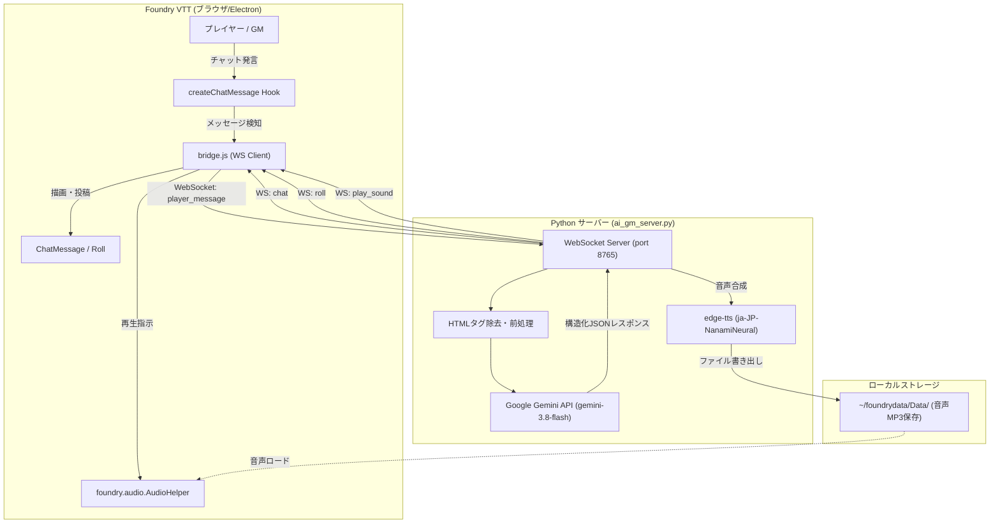
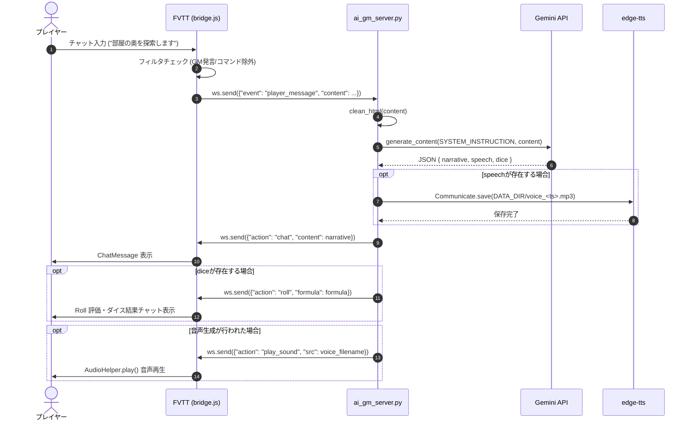

# AI GM Bridge システム仕様書

## 1. 基本情報

- **システム名称**: AI GM Bridge
- **モジュールID**: `ai-gm-bridge`
- **対象環境**:
  - Foundry Virtual Tabletop (FVTT): v11 〜 v14
  - Python: 3.12+ (現行環境: 3.14)
  - OS: Linux / WSL / macOS
- **目的**: Foundry VTT 上で動作するセッションにおいて、LLM (Google Gemini) を自律型ゲームマスター (AI GM) として組み込み、プレイヤーの発言に応じた情景描写、ダイス判定指示、音声合成による発話演出を自動で行う。

---

## 2. システム構成・アーキテクチャ

本システムは、FVTT 内で動作するクライアントモジュールと、外部で動作する Python WebSocket バックエンドサーバーの 2 層構成です。



---

## 3. コンポーネント仕様

### 3.1 Foundry VTT モジュール側

| ファイル | 種別 | 説明 |
| :--- | :--- | :--- |
| [`module.json`](file:///home/kenic/foundrydata/Data/modules/ai-gm-bridge/module.json) | マニフェスト | モジュールメタデータ、対応バージョン、エントリーポイント定義 |
| [`bridge.js`](file:///home/kenic/foundrydata/Data/modules/ai-gm-bridge/bridge.js) | ESModule | WebSocket クライアント、FVTT API フック、イベントディスパッチャ |

#### 動作要件・権限設計
- **GM 権限限定実行**:
  - `game.user.isGM` が `true` のクライアントのみ WebSocket 接続を開設。
  - 一般プレイヤーのクライアントがサーバーと通信することによる重複実行や無駄な負荷を防止。
- **再接続機能**:
  - 切断時 (`onclose`) は 5 秒間隔で自動再試行。
- **オーディオコンテキスト自動復帰**:
  - ブラウザの自動再生ポリシーによるサスペンド状態 (`game.audio.context.state === "suspended"`) を検知し、再生直前に `resume()` を実行。

#### フック処理 (`createChatMessage`)
- **発言フィルタリング**:
  - ループ防止: 送信者のエイリアスが `AI GM` で始まる場合は送信除外。
  - コマンド除外: 先頭が `/` (スラッシュコマンド) や `[` (マクロ等) で始まるメッセージは除外。
  - 通常のプレイヤー会話のみを抽出してサーバーに転送。

---

### 3.2 Python バックエンドサーバー側

| ファイル | 役割 |
| :--- | :--- |
| [`ai_gm_server.py`](file:///home/kenic/foundrydata/Data/modules/ai-gm-bridge/ai_gm_server.py) | メイン WebSocket サーバー。Gemini API 呼び出し、edge-tts 音声合成、FVTT へのメッセージ配信 |
| [`tools/test_send.py`](file:///home/kenic/foundrydata/Data/modules/ai-gm-bridge/tools/test_send.py) | チャット・ダイス音送信の単体疎通テスト用スクリプト |
| [`tools/test_voice.py`](file:///home/kenic/foundrydata/Data/modules/ai-gm-bridge/tools/test_voice.py) | 音声生成と FVTT 再生指示の単体疎通テスト用スクリプト |

#### 使用技術・ライブラリ
- **WebSocket**: `websockets` (ポート: `8765`, ホスト: `0.0.0.0`)
- **LLM**: `google-genai` (モデル: `gemini-3.8-flash`)
- **TTS**: `edge-tts` (ボイスモデル: `ja-JP-NanamiNeural`)

#### エラーハンドリング & レジリエンス
- **HTML クリーニング**: FVTT チャットに含まれる `<p>...</p>` などの HTML タグを正規表現で事前除去。
- **API 再試行 (Exponential Backoff)**: Gemini API が 503 過負荷を返した場合、最大 3 回まで指数関数的待機時間（2秒、4秒）を設けて自動再試行。

---

## 4. 通信プロトコル & データフォーマット

### 4.1 FVTT → Python サーバー

#### プレイヤー発言イベント (`player_message`)
プレイヤーが FVTT チャット欄に通常発言を行った際に送信されます。

```json
{
  "event": "player_message",
  "user": "string (発言プレイヤーの表示名)",
  "content": "string (発言テキスト本文)"
}
```

#### GM `/ai` コマンドイベント (`ai_command`)
GM がチャット欄で `/ai <プロンプト>` を実行した際に送信されます。

```json
{
  "event": "ai_command",
  "user": "string (GM表示名)",
  "prompt": "string (AIへの指示内容)"
}
```

#### チャット内ボタン選択イベント (`ai_choice`)
GM が対話型チャットカード上の選択肢ボタンをクリックした際に送信されます。

```json
{
  "event": "ai_choice",
  "user": "string (GM表示名)",
  "value": "string (選択肢の内部識別値。例: 'dungeon_size:small')",
  "label": "string (選択肢の表示名。例: '小 (100x100マス)')"
}
```

---

### 4.2 Python サーバー → FVTT

サーバーは Gemini の推論結果および音声合成の完了に応じて、以下のアクションメッセージを順次送信します。

#### 1. チャット描写 (`chat`)
情景描写やセリフを FVTT のチャットログに投稿します。

```json
{
  "action": "chat",
  "speaker": "string (表示名。既定値: 'AI GM')",
  "content": "string (チャット本文。リッチテキスト可)"
}
```

#### 2. ダイスロール (`roll`)
判定が必要な場合にダイスコマンドを実行させます。

```json
{
  "action": "roll",
  "speaker": "string (表示名。既定値: 'AI GM (判定)')",
  "formula": "string (ダイス計算式。例: '1d20', '2d6+3')"
}
```
※ サーバー側で `/r ` や `/roll ` プレフィックスを自動除去して送信します。

#### 3. 音声再生 (`play_sound`)
合成した音声ファイルまたはシステム効果音の再生を指示します。

```json
{
  "action": "play_sound",
  "src": "string (Dataディレクトリからの相対パス。例: 'voice_1728712345.mp3')",
  "volume": "number (音量 0.0〜1.0。既定値: 1.0)"
}
```

#### 4. インタラクティブ選択カード (`interactive_card`)
GM 向けに対話型の選択肢ボタンを含むチャットカードを表示します。

```json
{
  "action": "interactive_card",
  "title": "ダンジョン自動生成",
  "message": "生成するダンジョンの規模を選択してください：",
  "choices": [
    { "label": "小 (100x100マス)", "value": "dungeon_size:small" },
    { "label": "中 (500x500マス)", "value": "dungeon_size:medium" }
  ]
}
```

#### 4-2. 途中経過 (`progress`)
マップ生成・伝承・部屋の情景など待ち時間の長い処理の間、30 秒ごとに送ります。GM の画面に通知 (`ui.notifications.info`) として出し、チャットには残しません。

```json
{ "action": "progress", "message": "[部屋の情景] 完了 1/3 / 経過 30秒 / タイムアウトまで残り 570秒" }
```

待ち処理がタイムアウト (伝承・部屋の情景は agy 300 秒 / Gemini 120 秒、マップ生成 300 秒) を過ぎると、処理は続けたまま GM に `interactive_card` で延長を確認します。選択肢の値は `timeout_extend:<id>` (同じ秒数だけ延長) / `timeout_abort:<id>` (打ち切って既定の内容で続行) です。120 秒回答が無ければ打ち切ります。この回答はサーバーの受信キューを待たずに処理されます。

#### 5. ダンジョンシーン構築 (`create_dungeon_scene`)
生成されたマップ画像とパラメータを元に、FVTT 内部で `Scene.create` を実行させます。
`/ai ダンジョン` のウィザードは「舞台 (`dungeon_mode:<mode>`) → サイズ → 部屋密度 → 周回路」の順に選択カードを出します (野外は部屋密度を飛ばします)。

```json
{
  "action": "create_dungeon_scene",
  "scene_mode": "underground",
  "name": "地下迷宮 (小: 100x100)",
  "background_src": "dungeon_underground_100x100_1728712345.png",
  "grid_width": 100,
  "grid_height": 100,
  "grid_size": 100,
  "start_pos": [45, 60],
  "goal_pos": [80, 20],
  "walls": [[0, 0, 500, 0, "normal"], [500, 0, 500, 200, "door"]],
  "rooms": [{ "id": 1, "name": "部屋 1: …", "role": "start", "type": "start", "light_preset": "torch_warm", "ambient_sound_src": null, "cx": 350, "cy": 450, "grid_w": 4, "grid_h": 4 }]
}
```

- `scene_mode`: `underground` (暗さ 0.75) / `ruins` (暗さ 0.35) / `wilderness` (暗さ 0.35・全体光あり・壁なし)。省略時は `underground`。
- `walls[i][4]` (壁タイプ): `normal` / `door` / `secret_door` / `low_wall`・`rubble` (移動のみ遮り、視線・光・音は通す)。省略時は `normal`。
- `rooms[i].light_preset`: `torch_warm` / `bonfire_bright` / `magic_blue` / `acid_green` / `moonlight_dim` / `dark` / `null`。`null` で安全な休憩所なら焚き火を置きます。
- `rooms[i].ambient_sound_src`: 部屋の中心に置く環境音 (Data フォルダからの相対パス)。半径は部屋の長辺のマス数 × 1 マスの距離 × 0.85。

---

## 5. シーケンスフロー



---

## 6. 音声ファイル管理仕様

1. **保存場所**: `~/foundrydata/Data/` (`DATA_DIR`)
2. **命名規則**: `voice_<UNIX_TIMESTAMP>.mp3`
3. **再生指定**:
   - FVTT の `foundry.audio.AudioHelper.play` は `~/foundrydata/Data/` をルートとする相対 URL を要求するため、`src` にはファイル名（または相対パス）のみを渡す。
4. **クリーンアップ方針**:
   - セッション中に生成された古い一時音声ファイルは、将来的に定期削除またはセッション終了時に削除するメンテナンス処理を導入予定。

---

## 7. AI GM プロンプト & 出力スキーマ仕様

### システムプロンプト
```text
あなたはファンタジーTRPGの熟練ゲームマスター(GM)です。
プレイヤーの宣言を受け、以下のJSONフォーマットのみを出力してください。Markdownのコードブロック(```json)は不要です。

{
  "narrative": "チャット欄に表示する情景描写（セリフ含むリッチテキスト）",
  "speech": "音声読み上げ用テキスト（簡潔に1〜2文。記号や括弧は含めないこと）",
  "dice": "/r 1d20 などのダイスコマンド（判定が必要な場合のみ。不要なら null）"
}
```

### パラメータ設定
- `response_mime_type`: `"application/json"`
- 対象モデル: `gemini-3.8-flash`
